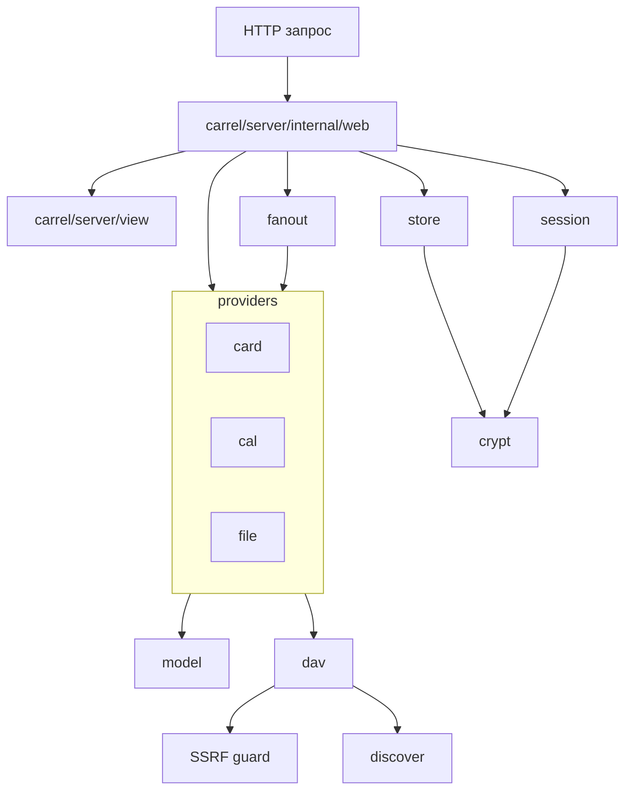

# Архитектура и структура репозитория

Закон — спеки: [typecase.md](../spec/typecase.md) (`L`), [carrel-server.md](../spec/carrel-server.md) (`S`), [carrel-common.md](../spec/carrel-common.md) (`C`). Этот файл закрывает то, чего в спеках нет: раскладка модулей, пины зависимостей, развилки, на которых Composer обычно ошибается.

---

## Правила для Composer

- Один шаг — один коммит, ворота зелёные (C-16). Коммит — только если пользователь просит.
- Правка по находке ревью: в том же коммите **сначала проверка, которая краснеет на текущем коде**, потом сама правка. Проверка, написанная после правки и сразу зелёная, не доказывает ничего (L-9.3). Этим правилом закрыты все находки Typecase; им же пойман Б-7, отмеченный закрытым, пока запасная ветка сохраняла исходный дефект.
- Ворота и проверки растут вместе с кодом, а не отдельным заходом «в конце». То же для каталога и фикстур: они заводятся с первой семьёй виджетов и с тех пор запускаются.
- Проверка не должна выводить оба сравниваемых списка из одного источника: ворота «Полнота» сверяли разметку со стилем, оба списка брали из кода и потому молча пропускали два виджета, объявленных в спеке и не написанных нигде. Сверять реализованное надо с объявленным в спеке (`spec-l4`), а не с ним же.
- Модуль `carrel/server` **не импортирует** `typecase`. Проверка воротами (`go list` / тест).
- В `carrel/server` нет шаблонов, CSS, классов `tc-*`, имён виджетов.
- Зависимость вне закрытого списка — стоп, спрашивать человека.
- C-6 не менять «для удобства». Расхождение фикстуры со схемой: чинится фикстура, если поля нет в C-6.
- Потолки из C-12 копировать как есть. Сроки сессий, TTL секретов, тело форм и частота — таблица **Сроки и лимиты** ниже; не C-12, не экран настроек, не «привычные» 30 минут сессии.
- iCalendar и vCard не собирать из полей формы. `Object.raw` неэкспортируем; наружу — вид для показа и патч (S-7).
- `map[string]any` во вью-моделях запрещён.
- Не делать клиент, desktop, сетку календаря, iTIP, офлайн-копию данных.
- `encoding/json` v1. Не `json/v2`, не `GOEXPERIMENT`.

---

## Модули

Монорепозиторий, **два Go-модуля**. Сервер — не корень репо и не сосед `typecase/` в корне: он лежит внутри каталога продукта. Клиент позже — `carrel/client/`; в этот план не входит.

| Папка | Модуль | Лицензия | Что знает | Чего не знает |
|---|---|---|---|---|
| [typecase/](../../typecase/) | `carrel.dev/typecase` | MIT | виджеты, токены, каталог | Carrel, DAV, вью-модели, маршруты |
| [carrel/server/](../../carrel/server/) | `carrel.dev/carrel/server` | AGPL-3.0-or-later | данные, ключи, DAV, сборка вью-моделей | классы, теги, шаблоны, Typecase |

Путь модуля совпадает с папкой после домена. Пока домена нет, `replace` не нужен: модули друг друга не импортируют. Когда появится клиент (`carrel/client`), его `go.mod` подключит `replace carrel.dev/typecase => ../../typecase` и `replace carrel.dev/carrel/server => ../server`.

Корневой `LICENSE` — AGPL продукта. У Typecase свой `typecase/LICENSE` (MIT). У сервера — `carrel/server/LICENSE` (AGPL-3.0-or-later). `THIRD_PARTY.md` лежит в том модуле, куда добавили зависимость, тем же коммитом.

`docs/` не переносится. `VERSION` в корне — версия продукта Carrel. Версия Typecase — теги вида `typecase/v0.1.0`.

---

## Дерево

Папок до начала кода нет: их заводит первый шаг плана — для оставшейся половины это [server.md](server.md); `typecase/` уже разложен. Сервер только в `carrel/server/`. Не класть `go.mod` сервера в корень репо и не заводить корневой `server/`.

```
/
  docs/spec/                 уже есть
  docs/visual/               уже есть
  docs/plan/                 эти файлы
  VERSION                    уже есть
  LICENSE                    AGPL, появляется с сервером
  typecase/                  отдельный модуль, не про Carrel
    go.mod                   module carrel.dev/typecase
    LICENSE                  MIT
    widget/
    token/
    css/  js/  fonts/  icons/
    catalog/
    screens/
    cmd/catalog/
    cmd/screens/
    testdata/broken/
  carrel/
    server/                  модуль серверной половины
      go.mod                 module carrel.dev/carrel/server
      LICENSE                AGPL-3.0-or-later
      cmd/carrel/
      cmd/carrel-wipe/
      view/                  C-6, C-8, C-9; JSON-теги = фикстуры
      internal/conf/
      internal/crypt/
      internal/store/
      internal/session/
      internal/dav/
      internal/discover/
      internal/model/
      internal/provider/card/
      internal/provider/cal/
      internal/provider/file/
      internal/photo/
      internal/fanout/
      internal/dupes/
      internal/web/
      internal/user/
      internal/mail/
      internal/backup/
      internal/publish/
      internal/proxy/
      testdata/
      Dockerfile
```

Пакет `carrel/server/view` — шов. Будущий клиент импортирует `carrel.dev/carrel/server/view`, не `internal`. Пакеты `internal/*` клиенту недоступны.

Сборка `cmd/carrel` живёт в модуле сервера. Когда появится клиент (`carrel/client/`), `cmd/carrel` начнёт импортировать Typecase; пакеты `internal/*` по-прежнему не должны.

---

## Зависимости на 04.09.2026

Проверено по go.dev и pkg.go.dev. Composer не подбирает «посвежее»: берёт указанные линии и записывает **точные** версии в `go.mod` в том же коммите.

**Toolchain.** Go **1.27.1** (01.09.2026). В обоих `go.mod`: `go 1.27`. В поддержке ещё 1.26.8. **1.25 и старше — EOL.**

### Typecase

Runtime: только стандартная библиотека.

Тесты: `github.com/chromedp/chromedp` **v0.16.0**. Chrome/Chromium в CI. Не Playwright, не npm.

Шрифты (OFL, в модуле, не CDN): Literata (заголовки), Public Sans (интерфейс), Source Code Pro (моно). IBM Plex нельзя — занят другим продуктом по бренд-гайду. Значки: библиотека даёт подачу, рисунки — из кадров Carrel, подставляются потребителем (L-5.1). В каталоге Typecase — нейтральный набор без доменных метафор.

### Сервер, runtime

| Модуль | Пин | Зачем |
|---|---|---|
| `golang.org/x/crypto` | **v0.56.0** | `argon2`, `chacha20poly1305`, `hkdf`, `curve25519`. Advisory GO-2026-5932 — только `openpgp`; этот пакет не импортировать. В stdlib Go 1.27 argon2 и XChaCha ещё нет |
| `golang.org/x/sync` | `@latest` на день первого `go get`, версия в `go.mod` | семафор веера |
| `golang.org/x/text` | то же | нормализация slug коллекции |
| `golang.org/x/image` | то же | DecodeConfig, webp при необходимости |
| `github.com/emersion/go-webdav` | **не `@latest`** (`@latest` = v0.7.0 от 18.10.2025). Брать `@master`, пол: `v0.0.0-20260625083450-1901d193ce99` | PROPFIND, REPORT, PUT, CalDAV/CardDAV/WebDAV |
| `github.com/emersion/go-ical` | `v0.0.0-20250609112844-439c63cef608` | iCalendar как мешок `Props`. Encoder пишет все свойства; список RFC — про мощность, не белый список |
| `github.com/emersion/go-vcard` | `v0.0.0-20260618161152-d854b7e0e2d3` | vCard как мешок свойств |
| `github.com/teambition/rrule-go` | **v1.8.2** | раскрытие RRULE. Серия правится целиком (S-11) |
| `github.com/yuin/goldmark` | **v1.8.6** | Markdown → `[]view.Block`. HTML-рендерер не используется. **Не v2** (на 02.08.2026 ещё `v2.0.0-beta.9`) |
| `filippo.io/age` | **v1.3.2** | шифрование архива копии паролем задания. Без флажка шифрования — голый zip |

Тесты сервера: `github.com/google/go-cmp` **v0.7.0**. Интеграция DAV — процесс **Radicale**, не заглушка и не Nextcloud в CI.

### Запрещено

gin, chi, echo, viper, zap, uuid-библиотеки, libvips, любой CGO, zipcrypto, `goldmark/v2`, `arran4/golang-ical` как хранилище объекта (типизированный `Event` провоцирует пересборку из полей — нарушение S-7), Node, npm, CDN.

htmx в этот план не кладётся: сервер HTML не рисует.

---

## Потоки данных



Зависимости только вниз. Транспорт не знает календарь. Модель не знает запрос. Провайдер не знает разметку. Typecase на этой схеме нет.

**Пока нет клиента.** Маршруты страниц, фрагментов и листов отвечают JSON вью-модели (`Content-Type: application/json`). Потоки, файлы, SSE, DAV, редиректы, `/healthz` — настоящие. Интерфейс `Renderer` в `internal/web`: сейчас `JSONRenderer`; HTML подставит клиент одной реализацией.

Сверка с фикстурами: анмаршал JSON в `view.*`, сборка, `cmp.Diff`. Байтовое равенство JSON не требуется.

---

## Закрытые развилки

Эти решения не пересматриваются в ходе реализации. Нет в списке — смотреть спеку, не выдумывать третье.

**Крипто (S-2).** Argon2id (`x/crypto/argon2`). AEAD — XChaCha20-Poly1305. Ключ данных — 32 случайных байта, один на жизнь учётки. Обёртка: AEAD, AAD `carrel.wrap.v1|<login>`. Блоб: AAD `carrel.blob.v1|<login>`. Состояние тома: AAD `carrel.state.v1|<version>`. Две соли: логин и wrap. Параметры KDF хранятся в записи; числа и мин. длины — таблица **Сроки и лимиты**. Fable на первом аудите может пересмотреть **только** Argon2id. `CARREL_DATA_DIR/server.key`: 32 байта, `O_EXCL`, `0600`, никогда не перезаписывать; короткий или битый — отказ запуска. Депонирование: X25519 + HKDF-SHA256 + XChaCha20-Poly1305, эфемерный ключ. Затирание в `session.End` — best-effort; дамп памяти побеждает (S-29.2).

**Том.** JSON внутри AEAD. Магия `CRL1`, uint32 версии, 24-байтовый nonce. Запись: tmp + fsync + rename в том же каталоге. Журнал аудита — той же атомарной операцией. Файл более новой версии — reject, не разбор наугад.

**HTTP.** `net/http` ServeMux с паттернами Go 1.22+. Сессии только в памяти. Кука `carrel_sid`: HttpOnly, SameSite=Lax, Secure если HTTPS через доверенный прокси. CSRF: после входа — токен сессии; до входа — кука `carrel_csrf` (двойная подача, ниже). Проверка **до** обработчика; поле `_csrf` (urlencoded и multipart) и заголовок `X-CSRF-Token`. Смена SID при входе. Потолок тела форм и частота — таблица **Сроки и лимиты**; ведро в памяти, не Redis.

**CSRF до входа (Ф2-15, 07.09.2026).** Login-CSRF: чужой сайт POST'ит `/login` чужими логином и паролем; браузер человека оказывается в чужой учётке. `SameSite=Lax` на `carrel_sid` не защищает — куку ставит ответ. Не предсессия (память на каждого посетителя GET) и не одна проверка `Origin` (C-11 — токен в форме). GET `/login`, `/register`, `/forgot`, `/setup` и форм по токену (`/invite/{token}`, `/forgot/{token}`) ставит куку `carrel_csrf` (32 случайных байта, HttpOnly, SameSite=Lax, Secure как у SID, Path = `CARREL_BASE_PATH`, пусто = `/`) и то же значение в `_csrf` вью-модели. POST сверяет куку с `_csrf` или `X-CSRF-Token` до обработчика; нет куки или не совпало — 403, обработчик не зовётся. Серверного состояния нет: два значения из запроса. После смены SID действует токен сессии; `carrel_csrf` SID не заменяет. C-11 читается: токен в каждой форме, в том числе до входа — не «токен сессии».

**CSRF и multipart (07.09.2026).** `ParseForm` не разбирает `multipart/form-data`; без заголовка поле `_csrf` в загрузке не видно. Не «клиент всегда шлёт `X-CSRF-Token`»: без сценариев загрузка и импорт обязаны работать (U-8), а нативный POST заголовок не ставит. Сервер берёт `_csrf` из multipart в пределах потолка маршрута (1 МиБ у форм, C-12 у фото и импорта, без потолка у файлов); часть текстовая, не файл. `X-CSRF-Token` сверяется первым и тело не читает — так сценарий может не буферизовать файл ради токена. Заголовок не заменяет поле в форме. C-11: `_csrf` в каждой форме, включая multipart.

**SSRF.** Резолв → проверка IP (петля, RFC1918, link-local, ULA, multicast, CGNAT `100.64.0.0/10`, IPv4-mapped IPv6) → `DialContext` на **этот** IP, `tls.ServerName` = исходный хост. Повтор после каждого редиректа. Потолок редиректов — C-12. Allowlist — хосты, не сети. Сверх списка (аудит Fable №1, Ф-1): встроенный IPv4 из NAT64 `64:ff9b::/96`, `64:ff9b:1::/48` и 6to4 `2002::/16` проверяется как IPv4; `::/96`, `::ffff:0:0:0/96`, Teredo `2001::/32`, `fec0::/10`, `0.0.0.0/8`, `240.0.0.0/4`, `192.0.0.0/24` — отказ. Учётные данные подключения ставятся в запрос **до** `Client.Do`, не в `RoundTrip`: Go снимает `Authorization` при переходе на чужой хост только в этом случае (Ф-15). Подключение по `http://` **разрешено**: состояние-предупреждение на экране подключения, не отказ — проблема с сертификатом у человека не должна становиться отказом в обслуживании (решение 05.09.2026, Ф-13). Самоподписанный или непроверяемый сертификат на `https://` — то же: предупреждение, не отказ (решение 05.09.2026). Реализация — требование аудита: проверка стандартная, `InsecureSkipVerify` для всех подключений нельзя; при отказе проверки подключение идёт только с отпечатком SHA-256 листового сертификата, явно принятым человеком на этом подключении и хранимым в его блобе; смена отпечатка — снова предупреждение, не молчаливое доверие. `tls.ServerName` и страж без изменений.

**Патч.** Закрытый набор операций (`SetText`, `AddValue`, `RemoveProp`, …). Пустое значение ≠ удаление. UID и VERSION не патчатся. После успешного PUT — перечитать и `LossReport`.

**C-10.** Английские строки как в кадрах. Пояс — один на экземпляр. 12/24 — из аккаунта. Цвет **метки коллекции** — с сервера (`calendar-color`); нет — SHA-256 пути → 8 приглушённых тонов, не чистые hue (C-10). Акцент оболочки этим не задаётся.

**Дубликаты.** Очки: email норм. = 50, телефон (последние 10 цифр) = 50, UID = 80, имя fold-equal = 20, день рождения = +10. Порог 60. Одно сильное проходит; слабые вместе — нет. Сравнение только внутри корзины. События: тот же UID или DTSTART+summary. Задачи: заголовок+срок. Заметки: заголовок+дата, не тело.

**Slug коллекции.** NFD → закрытая таблица кириллицы в `internal` (без отдельного модуля) → lower → пробелы в `-` → `[a-z0-9-]` → пусто → `col` → коллизия `-2`. `..`, `/`, ведущая точка — отказ.

**ID (07.09.2026).** Один генератор: 10 символов Crockford base32 из 6 случайных байт, не из URL и не из логина. Префикс — род сущности, иначе в журнале и панели человек и подключение неразличимы (C-4: `{account}` — подключение). Подключение: `a-` (`NewAccountID`). Человек (`User.ID`): `u-` (`NewUserID`). Приглашение (`Invite.ID`): `i-` (`NewInviteID`). Веерная задача: `t-` (`NewTaskID`). Задание копии: `b-` (`NewJobID`). UID записи на DAV — 32 hex из 16 случайных байт, не этот генератор. `a-nc-home` в фикстурах — только тестовые данные. Пока живых томов нет — не миграция.

**Unlock (S-10.7, 07.09.2026).** Окно выдачи секретов живёт в сессии (`UnlockUntil`), не в учётке. «Везде сразу» — три места (пароль подключения, профиль устройства, депонирование) делят одни часы этой сессии. Другое устройство того же человека подтверждает свой пароль. Иначе украденная кука наследует окно.

**URL.** `{col}` — один сегмент, `/` → `%2F`. `{path…}` у файлов — посегментно; `..` отвергать, не нормализовать.

**Веер.** Параллельность источников и потолок живых задач — таблица **Сроки и лимиты**, не настройка. Таймауты — C-12. Задача — объект в сессии, не счётчик слотов. Интерфейс `Source` живёт в `internal/fanout`, общего `internal/provider` нет. Отмена контекстом.

**davloom.** `CARREL_DAVLOOM_PORT` пусто = выключен. Иначе второй listener в том же процессе, свои лимиты. В C-12 этой переменной нет — она добавляется здесь.

**Markdown.** AST goldmark → `[]view.Block`. Выделение и ссылки — вложенные Kind C-8 (`emph`, `strong`, `link`), не сплющенный текст. Сырой HTML — экранированный текст в `BlockPara`. HTML-рендерер goldmark не подключать. Kind — только C-8 (`para`, `heading`, `list`, `item`, `code`, `quote`, `link`, `emph`, `strong`); неизвестный узел AST с текстом — `BlockPara`, нового Kind нет.

**Фото.** `DecodeConfig` до декода; сторона записи, JPEG, потолок загрузки и пикселей — C-12 (`CARREL_PHOTO_*`). Ориентация из APP1 (тег 0x0112), без библиотеки EXIF; JPEG без EXIF; без CGO. `x/image` — webp и `draw`, не libvips и не nfnt. `TYPE=JPEG` → `image/jpeg`. Пайплайн — `internal/photo` (S-13), не пакет `card`. URI PHOTO фетчит только `photo` через страж.

**Провайдеры (08.09.2026).** Три пакета `internal/provider/{file,card,cal}`, общего `internal/provider` и общего интерфейса нет — веер (S-15) заведёт, если понадобится. Страницы C-6 собирает `web` (S-9); провайдер не импортирует `internal/web` и не заполняет `*Page` / `Shell` / `Action`. Исключения: goldmark → `[]view.Block`; `card.Foreign` → `[]view.Field`. `Transport` не расширять. Создание — `If-None-Match: *` интерфейсом `dav.Creator` (`PutCreate`); `*Client` его реализует. Обновление — `Put` с ETag; пустой `ifMatch` провайдеры записей не передают (S-8). Безусловный PUT — только S-17 «перезапись по требованию». PHOTO с `VALUE=uri` не фетчить: это чужой адрес, страж его не видел. Parse/encode — `go-ical` / `go-vcard` как мешок свойств, пины из таблицы; транзитивный `go-vcard` из `go-webdav` не брать. `goldmark` **v1.8.6** — прямой `require`. `rrule-go` **v1.8.2** — прямой `require`: `Expand` собирает `rrule.Set` (RRULE − EXDATE + RDATE); `Component.RecurrenceSet` отбрасывает RDATE без RRULE — не звать. `NewObject` не ломать; дерево VCALENDAR — `NewCalendarObject`, сигнатуры `Patch` не трогать. `Join`: отказ `.`, `..`, пустой, слэш, обратный слэш — не всякое имя с ведущей точкой. Известные vCard — то, для чего в C-6 есть место; RFC-свойство вне этого набора идёт в `Foreign` (S-7.2).

**Сроки и лимиты (не C-12).** Спека говорит «есть срок / есть лимит», чисел не даёт. Ниже — закон для Composer. Именованные константы в коде (`internal/conf` или пакет, которому принадлежат), не переменные C-12, не `CARREL_*`, не поля формы «Лимиты». Потолки из C-12 сюда не копировать.

Fable на первом аудите может пересмотреть **только** строки Argon2id. Сессии, TTL секретов, тело POST и частота — продуктовые, без человека не трогать.

| Что | Значение | Как применять |
|---|---|---|
| Простой сессии | **12 ч** без запросов | Любой запрос с живой SID сдвигает простой. Истечение = выход: ключи и кэш затираются |
| Абсолютный срок сессии | **7 суток** с входа | С входа (смены SID), не сдвигается. Что раньше — простой или абсолют, то и конец |
| Срок приглашения | **7 суток** | С создания. «Продлить» = now + 7 суток, секрет не менять. «Отправить повторно» = новый секрет и новый срок 7 суток |
| Подтверждение адреса | **48 ч** | Срок ссылки, не незавершённой записи. Истекла — повторная подача той же формой (S-10.2). Запись сами не удалять |
| Ссылка `/forgot` | **24 ч** | С выдачи. Сгорает раньше, если задан новый пароль. После очистки до пароля та же ссылка жива, пока не вышел срок |
| Ссылка из консоли | **15 мин**, одноразовая | Тот же двухшаговый wipe, что у письма. Повтор команды — новый секрет, старый мёртв. Не копировать 24 ч |
| Скачивание профиля устройства | **5 мин**, одноразовая | Отдельно от `CARREL_UNLOCK_TTL` (часы листа S-10.7). GET сжигает ссылку. Не кэшировать |
| Публичная ссылка по умолчанию | **30 суток** | При создании, если человек не выбрал иное. Явный «без срока» разрешён: `Expires` в C-6 не расширять, пустой показ = без срока. Отзыв есть всегда |
| Потолок тела обычного POST | **1 МиБ** | Формы, JSON, `_csrf`. Фото и импорт — C-12. Файлы на чужой WebDAV — своего потолка нет. Сверх лимита — 413, тело дальше не читать |
| Вход и регистрация, по учётке | **5 / мин** | POST входа и POST саморегистрации. Ключ — нормализованный логин из поля, даже если записи нет |
| Вход и регистрация, по IP | **20 / мин** | Тот же POST. Оба порога сразу. Нет / неверно / отключено неотличимы |
| Анонимные токены, по IP | **30 / мин** | `/invite/{token}`, `/forgot`, `/forgot/{token}`, подтверждение адреса, `/p/{token}`, внешний триггер копии, GET формы саморегистрации. Не делить «нет / отозвано / истекло» |
| `/healthz` и «О сервисе» | без этих вёдер | Пробы и обязательство лицензии не ловят 429 |
| После входа | не 5 / мин | Стол шлёт фрагменты. Общий bucket **не жёстче 120 / мин** на сессию; отдельной настройки нет |
| davloom | те же числа, свои вёдра | С веб-портом не делит. Listener свой |
| Живых вееров на сессию | **4** | Пятый не стартует, пока не кончится или не отменят. Подметаются с сессией |
| Параллельность источников в веере | **4** | На одну задачу. Не настройка |
| Мин. длина пароля человека | **8** | Приглашение, смена, пароль от администратора, саморегистрация, новый пароль после wipe |
| Мин. длина мастер-пароля | **16** | Только депонирование |
| Argon2id login и wrap | t=**3**, m=**64 MiB**, p=**1** | Две соли, два применения. Параметры пишутся в запись |
| Argon2id мастер депонирования | t=**4**, m=**256 MiB**, p=**1** | Нигде не кэшируется |

Ведро — token bucket в памяти процесса. 429 без различимых тел для «нет / отозвано / истекло». Unlock листа секретов — `CARREL_UNLOCK_TTL` = 300 с из C-12.

Именованные константы рядом с таблицей, тоже не `CARREL_*`: `AttachInlineMax` = **2 МиБ** (S-20; коллекция может только опустить через `max-resource-size`); `FileThumbMaxBytes` = **512 КиБ** (S-17: оригинал как миниатюра, иначе значок).

**Копия.** zip + манифест. `Encrypted=true` по умолчанию → age passphrase поверх zip. Выключено — голый zip. Архив на том Carrel не класть. Внешний триггер без сессии — только с явно сохранённым конвертом ключа данных в `store.State`.

**Публикация (08.09.2026).** Живое чтение, не копия. Секрет в `store.State` свёрткой. Пароль подключения для `/p` — вложенный AEAD `server.key`, AAD `carrel.publish.v1|<hash>`, только пока есть живая ссылка на это подключение. Не класть в State пароли всех подключений.

**Функции S-11…S-26 (08.09.2026).** Закон — раздел в [server.md](server.md). Кратко: каталог коллекций в блобе до проводки GET; `Transport` не расширять (`Copy` нет; безусловный PUT только `file.UploadOverwrite`); `Get` без `LimitReader` на теле (потолок C-12 остаётся на PROPFIND/REPORT); VALARM правит `cal.SetAlarms`, не новый `PatchOp`; единый вид — `Selected` в блобе, пустой ≠ все; веер заводит `Source`; дубликаты только по кэшу; почта — `net/smtp`, From экземпляра; QR профиля пустой, пока нет пина библиотеки.

**Фикстуры.** Анонимный embed `Shell`. JSON-теги camelCase с маленькой буквы. `null` для указателей. Поля `section` из README фикстур в C-6 нет — не заводить.

---

## Готовность

| Часть | Готова, когда |
|---|---|
| Typecase | L-11.2: каталог, ворота L-8, L-9.3 кусается, тег `typecase/v0.1.0` |
| Сервер | C-14.2 / S-30: каждый маршрут C-5 отвечает, вью-модель равна фикстуре, ни одного шаблона, ни одного импорта typecase |

Соединение экранов — отдельный план клиента.
