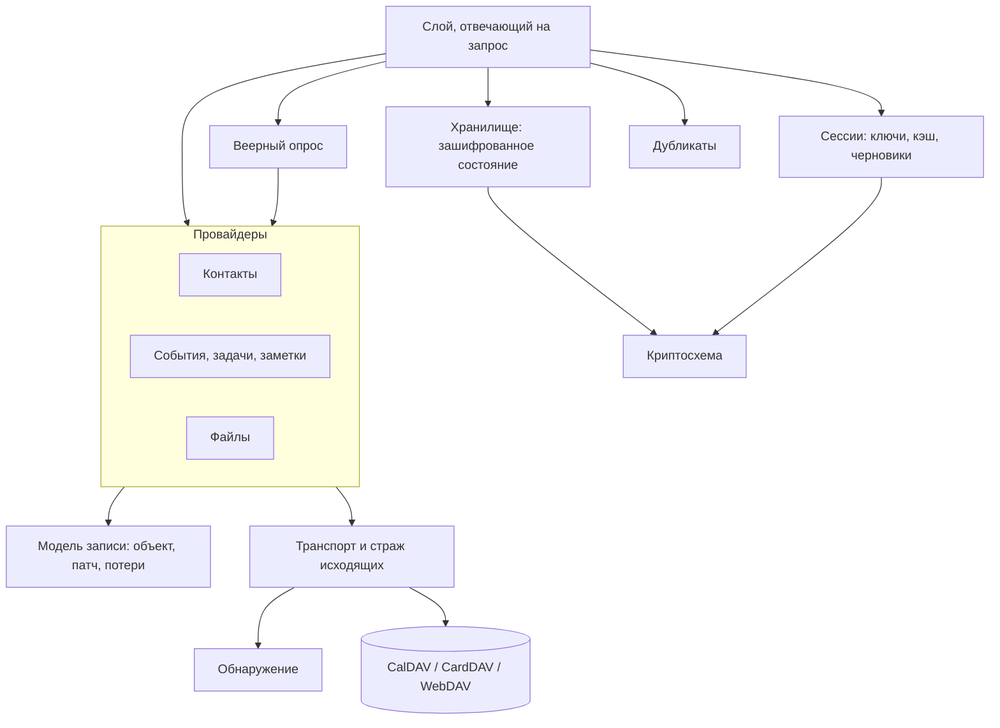

# Carrel — серверная половина

Всё, что добывает данные и отдаёт заполненную вью-модель: ключи, хранилище,
сессии, DAV-транспорт и обнаружение, модель записи, слой, отвечающий на запрос, и
функции поверх них.

**Чего в этой половине нет.** Ни одного класса, ни одного тега, ни одного имени
шаблона. Сервер не рисует и не знает, как выглядит то, что он отдал.

| | |
|---|---|
| Контракт, которому сервер отдаёт вью-модели | [carrel-common.md](carrel-common.md) — `C-…` |
| Кадры экранов, для которых собираются данные | [carrel-ui-mockups.html](../visual/carrel-ui-mockups.html) |

Порядок разделов — от основания к надстройке: это порядок зависимостей, а не
график работ.

---

## Оглавление

| § | О чём |
|---|---|
| S-1 | Слои и границы |
| S-2 | Криптосхема |
| S-3 | Хранилище |
| S-4 | Сессии и кэш |
| S-5 | Транспорт и ограничение исходящих подключений |
| S-6 | Discovery и проверка сервера |
| S-7 | Модель записи и сохранение чужих свойств |
| S-8 | Конфликты |
| **S-9** | **Слой, отвечающий на запрос** |
| S-10 | Пользователи и администрирование |
| S-11 | Данные: роды записей, повторы, напоминания, пояса |
| S-12 | Коллекции: завести, переименовать, перенести, удалить |
| S-13 | Фотографии контактов |
| S-14 | Единый вид |
| S-15 | Веерный опрос, поиск и история запросов |
| S-16 | Дубликаты |
| S-17 | Файлы |
| S-18 | Перемещение и копирование записи |
| S-19 | Импорт и экспорт |
| S-20 | Вложения: внутри записи и в папке |
| S-21 | Деградация |
| S-22 | Прозрачность: состояние коллекции и исходный пояс |
| S-23 | Новое устройство |
| S-24 | Резервное копирование |
| S-25 | Публикация и подписки |
| S-26 | Почта |
| S-27 | davloom — режим DAV-прокси |
| S-28 | Поставка |
| S-29 | Безопасность сводно |
| S-30 | Критерии приёмки и план проверок |

---

## S-1. Слои и границы

### S-1.1 Одна мысль

**Данными владеет DAV-сервер. Carrel владеет сессией.**

Ничего из контактов, календарей и заметок не пишется на диск. На томе лежит
список тех, кто может войти, их зашифрованные учётные данные и их решения о
дубликатах — последнее есть сведения о чужих коллекциях и потому запечатано так
же. Всё остальное живёт в памяти одной сессии и умирает вместе с ней.

Из этого следует всё остальное: нечего согласовывать, нечего мигрировать, нечего
подать устаревшим, когда сервер недоступен, и украденный том не выдаёт ничью
адресную книгу. Отсюда же то, что перезапуск выводит всех: ключ, открывавший
учётные данные, был только в памяти.

### S-1.2 Слои



Зависимости направлены в одну сторону. Транспорт не знает, что такое календарь;
модель не знает, что такое запрос; провайдер не знает, что такое разметка.

### S-1.3 Три правила, которые не обсуждаются

| Правило | Почему оно структурное, а не дисциплинарное |
|---|---|
| **Только верхний слой знает, что такое запрос.** Всё ниже принимает контекст и аргументы | Провайдер, узнавший про форму, — провайдер, который без формы не проверяется |
| **Никогда не пересобирать объект из полей формы** (S-7) | Так теряются чужие свойства во всех клиентах, и никто не делает этого нарочно |
| **Никогда не писать без предусловия** (S-8) | Создание условно по отсутствию, обновление — по прочитанной версии. Третьего случая нет |

### S-1.4 Куда класть изменение

| Если вы… | Работайте в |
|---|---|
| добавляете метод DAV или запрашиваемое свойство | транспорте (S-5) |
| меняете, как находят сервер | обнаружении (S-6) |
| добавляете свойство iCalendar или vCard | модели (S-7), затем в виде для показа и в патче |
| меняете, как читаются и пишутся записи | провайдере |
| меняете, что помнится между заходами | запечатанном блобе (S-3) |
| меняете, что помнится в пределах сессии | сессии (S-4) |
| добавляете настройку | конфигурации, и проводите её через то, что запускает процесс |
| собираете вью-модель | верхнем слое (S-9), и нигде больше |

---

## S-2. Криптосхема

Пароль входа используется дважды, и **смешивать эти два применения нельзя**.

1. **Проверка входа.** Из пароля и своей соли выводится проверочное значение;
   сравнение — за постоянное время.
2. **Ключ шифрования.** Из пароля и **другой** соли выводится ключ обёртки. Он
   разворачивает ключ данных — 32 случайных байта, которыми зашифрованы учётные
   данные подключений и решения о дубликатах.

Соли разные, чтобы одно применение нельзя было использовать для атаки на другое.

**Ключ данных создаётся один раз** и не меняется. Он хранится завёрнутым под ключ
обёртки, поэтому смена пароля перезаворачивает его, а всё зашифрованное остаётся
читаемым. Отсюда: человек, меняющий свой пароль, сохраняет подключения, а
разрушительный сброс администратором — нет.

**Каждое шифрование несёт свою различающую добавку**, поэтому завёрнутый ключ
нельзя подставить вместо запечатанного состояния и наоборот.

**Параметры вывода ключа хранятся рядом с записью**, а не зашиты в код: стоимость
можно поднять позже, никого не заперев снаружи. Три набора параметров: проверка
входа, вывод ключа обёртки и мастер-пароль депонирования — последний самый
дорогой, потому что это единственный секрет экземпляра, открывающий чужие данные.

**Ключ сервера** создаётся при первом запуске в каталоге данных, с исключительным
созданием и правами только для владельца, и **никогда не перезаписывается**:
короткий или нечитаемый файл ключа объявляется испорченным, а не заменяется —
замена молча уничтожила бы состояние, которое он открывает. Он защищает то, что
должно читаться до входа кого бы то ни было: настройки, записи пользователей,
пароль почтового реле.

**Депонирование** (S-10) — пара ключей. Открытый лежит открыто, закрытый
зашифрован мастер-паролем администратора и нигде не кэшируется; копия ключа
данных человека шифруется открытым ключом, поэтому **депонирование не требует
никаких секретов**. Эта асимметрия и есть суть: включение схемы не может
дотянуться до учётных записей, заведённых раньше, потому что открыть их ключ
данных без их пароля невозможно.

**Затирание ключевого материала** вызывается на каждом пути, которым кончается
сессия. Оставить ключи сборщику мусора — это решение, и здесь принято другое.

---

## S-3. Хранилище

Всё состояние службы — **один зашифрованный файл** на томе, запечатанный ключом
сервера.

- **Запись атомарна:** во временный файл, затем переименование. Изменение
  становится видимым в памяти только после того, как дошло до диска — неудачная
  запись не оставляет ни записи, ни строки журнала, которую она бы породила.
- **Пустой том — рабочее состояние**, а не отказ запуска: хранилище поднимается в
  режиме первого запуска и не пишет ничего до первого изменения. Это ведёт на
  экран создания первого администратора.
- **Формат несёт версию** и точку миграции. Файл от более новой сборки
  **отвергается**, а не разбирается наугад.

**Журнал действий** дописывается в конце и пишется **той же атомарной
операцией**, что и изменение, которое он описывает. Он ограничен по размеру,
чтобы долго живущий экземпляр не рос без предела, и записывает, кто что с кем
сделал — никогда пароль, токен или содержимое записи.

**Запечатанный блоб** есть у каждого человека, и он запечатан его собственным
ключом данных: подключения с обнаруженными коллекциями, выбор источников по
разделам, решения о дубликатах и порог. Хранилище умеет **сосчитать**, сколько у
человека подключений, не открывая блоб: счёт — всё, что нужно администрированию,
и содержимого его не касается.

---

## S-4. Сессии и кэш

### S-4.1 Сессия

Сессии живут только в памяти. Каждая держит ключ данных человека, токен для
изменяющих запросов, сроки простоя и жизни и три вещи, переживающие один запрос,
но не сессию:

- **кэш** (S-4.2);
- **черновики**: отвергнутая правка, ждущая решения о расхождении; загруженная
  фотография, ждущая кадрирования; разобранный импорт, ждущий подтверждения;
- **историю запросов** и последнюю выдачу поиска — десять строк, вытеснение с
  конца;
- **реестр потерь**: что данный сервер уже был замечен теряющим (S-7).

Выход, истечение и перезапуск стирают всё это. Другая сессия того же человека
истории и кэша не видит. Ни в интерфейсе, ни на каком маршруте один человек не
достаёт этого у другого.

### S-4.2 Кэш

**Что кэшируется:** список коллекций после обнаружения; карта «путь → версия» по
коллекции; тела объектов по ключу «путь и версия вместе»; миниатюры фотографий по
версии объекта и миниатюры картинок-файлов по версии файла (S-17.1); раскрытые повторы по диапазону; листинги файловых папок;
размеры картинки по версии файла (S-17.1).

**Инвалидация.** Ключ включает версию, поэтому устаревшее тело физически
недостижимо. Кроме того: после успешной записи или удаления запись по пути
выбрасывается; перед чтением коллекции сверяется её метка изменения — не
изменилась, карта берётся из кэша без запроса; для серверов без такой метки
действует мягкий срок; на каждом экране есть обновление.

**Границы.** Потолок на сессию с вытеснением давно не использованного и отдельные,
более жёсткие потолки на фотографии контактов и на миниатюры файлов — у каждого
свой, по байтам и по числу записей: книга контактов и папка с картинками друг
друга не вытесняют, а миниатюра файла дороже в повторе — её файл читается с
чужого сервера целиком. **Тела объектов вытесняются раньше карт
версий**: иначе нехватка памяти заставит на следующем заходе делать глубокий
обход коллекции — выбрасывается дорогое, а не дешёвое. Поверх этого — потолок на
весь процесс, вытесняющий через все живые сессии, чтобы десять человек с большими
книгами вместе не исчерпали контейнер. Данные при этом не смешиваются: бюджет
процесса держит указатели на кэши сессий, а не копии тел.

**Чего кэш не делает.** Не позволяет работать при недоступном сервере — при отказе
показывается отказ, а не устаревшее. Не переживает перезапуск. Не заменяет
предусловие при записи.

---

## S-5. Транспорт

Транспорт — это методы протокола и ничего больше. Он не знает, что такое
календарь.

```go
type Transport interface {
    PropFind(ctx context.Context, path string, depth Depth, props []xml.Name) (*MultiStatus, error)
    Get(ctx context.Context, path string, rng *Range) (io.ReadCloser, string, error)
    Put(ctx context.Context, path string, body io.Reader, ifMatch string) (string, error)
    Delete(ctx context.Context, path, ifMatch string) error
    MkCol(ctx context.Context, path string) error
    MkColProps(ctx context.Context, method, path string, props []Prop) error
    PropPatch(ctx context.Context, path string, set []Prop, remove []xml.Name) error
    Move(ctx context.Context, src, dst string, overwrite bool) error
}
```

**`Get` возвращает поток, а не срез байт.** Это самая нагруженная строка
пакета: провайдеры записей вычитывают поток сразу, потому что им его разбирать, а
файловый пробрасывает браузеру. С массивом байт файловый раздел означал бы
переписывание транспорта, а большая загрузка — свой размер в памяти на каждого
читающего.

**Отчёты и условная запись — отдельные интерфейсы**, а не часть этого: это не
плоский DAV, и нужны они только двум провайдерам из трёх. Держать их снаружи —
то, что позволяет файловому провайдеру честно удовлетворять меньший интерфейс.

### S-5.1 Страж исходящих подключений

Человек задаёт адрес, сервер по нему идёт. Без стража это сканер чужой сети,
которым управляет всякий, кто может войти.

- Имя резолвится, **полученный адрес проверяется** против петлевых, частных,
  локальных для канала и групповых диапазонов, и подключение идёт **к уже
  проверенному адресу**, а не к повторно разрешённому имени: второй ответ службы
  имён — простейший обход.
- Проверка выполняется **после каждого перенаправления**, а не только для
  исходного адреса; длина цепочки ограничена.
- Список исключений существует для того, у кого DAV-сервер действительно в
  локальной сети. Он пуст по умолчанию и **называет хосты, а не сети**.
- Тайм-ауты на подключение и на весь запрос и потолок ответа — часть того же
  объекта, поэтому ничто не уходит к чужому серверу без них.
- **Соединение, закрытое между запросами, повторяется один раз.** Пул живёт в
  страже, поэтому эту гонку наследуют все клиенты процесса, а Go повторяет сам
  только методы, которые считает безопасными, — `PROPFIND` и `REPORT` не из их
  числа. Читающий запрос уходит второй раз при любой такой ошибке. Пишущий —
  **только если соединение взято из пула простаивающим** и тело можно отдать
  заново: тогда сервер закрыл свою сторону ещё до запроса и не видел его.
  Соединение, поднятое ради этого запроса, не повторяется: там ошибка ничего не
  говорит о том, что сервер успел сделать. Второе основание того же: всякая
  запись Carrel условна (S-8) или идемпотентна, поэтому долетевшая дважды
  отвергается предусловием, а не удваивается.

Страж действует на **все** исходящие: обнаружение, подписки, вложения, целевое
хранилище копий, внешние изображения.

---

## S-6. Discovery

Порядок шагов:

1. Хорошо известные адреса для календарей и адресных книг, с переходами.
2. При неудаче — **введённый адрес как есть**. Это основной путь: у части
   серверов хорошо известные адреса живут в конфигурации веб-сервера, которой
   часто нет, а прямой путь работает всегда.
3. Запрос принципала текущего пользователя.
4. Из принципала — домашние наборы календарей и адресных книг.
5. Обход обоих наборов на глубину один.

**Планирование спрашивается у принципала** одним запросом после шага 3:
`schedule-outbox-URL` и `calendar-user-address-set` (RFC 6638). Есть ящик
исходящих — сервер планирует и при правке участников может разослать письма;
принципал ответил без него — не планирует; принципала нет или он не ответил —
неизвестно, и так и сказано там, где это важно (S-15.4). Набор адресов — какие
адреса календаря принадлежат самому человеку. Оба ответа хранятся у
подключения и обновляются при его правке и применённом повторном
обнаружении; подключение, заведённое раньше, остаётся «неизвестно», пока его
не поправят или не обнаружат заново. Отказ этого запроса обнаружения не
проваливает: шаг пишется в след, как любой другой.

Забираются: имя для показа, род ресурса, цвет, набор поддерживаемых компонентов,
права текущего пользователя, метка изменения, отметка удаления. Права определяют, показывать ли
элементы правки; коллекции только для чтения помечаются.

**Один принципал отдаёт и календари, и адресные книги** — подключение это одна
связка, а не одно подключение на протокол.

**Ответ, не называющий принципала, — не отказ.** Это свойство календарного и
адресного протоколов, и обычный WebDAV его не объявляет: тогда введённый адрес и
есть файловая коллекция, а шаги 4 и 5 пропускаются. Отказ в доступе или разметка
там, где ожидался ответ протокола, — по-прежнему отказ.

**Но сначала спрашивают род самого введённого адреса.** Принципала может не быть
потому, что человеку выдали ссылку **на одну коллекцию**, а не на дом: так
раздают календари Mail.ru и подобные. Календарный или адресный признак в роде
ресурса означает именно это — подключение держит одну коллекцию, взятую с её
именем и составом компонентов, домашних наборов у него нет, а файловой она не
считается. Без этой проверки календарь по ссылке становится папкой: род ресурса
у файловой коллекции — тот, в котором календарного и адресного признака нет.

**Коллекция, которую сервер считает удалённой, — не коллекция.** У сервера с
корзиной удалённый календарь остаётся по своему адресу и остаётся среди детей
дома, а род ресурса называет его календарём, пока не спросишь про удаление:
Nextcloud отвечает так и только на вопрос про своё `deleted-at` признаёт правду
(docs/servers.md, SV-30). Поэтому обход спрашивает и об этом — в том же запросе,
что цвет и метку изменения, — и помеченное удалённым в список не попадает, а
след говорит, сколько таких пропущено. Иначе удалённая человеком коллекция
возвращается в список при следующем обнаружении.

**Диагностика обязательна.** Обнаружение — самая частая точка отказа, и «не
подключается» не то, с чем человек может что-то сделать. Каждый шаг пишется в
след с тем, **что именно ответил сервер**, и след — это то, что показывает экран
подключения (`DiagnosticTrace`, C-9).

**Файловые коллекции** — плоские коллекции под корнем: род ресурса без
календарного и адресного признака, не контейнер чужого домашнего набора.
Определяются автоматически, отдельной настройки нет. Раздел файлов в навигации
**всегда на месте**: нет ни одной такой коллекции — он объясняет, почему пуст.

### S-6.1 Повторное обнаружение

Список коллекций, снятый один раз при подключении, устаревает: коллекцию удаляют
и заводят другим клиентом. Поэтому обнаружение запускается повторно — по явному
действию человека, а не на каждое обновление экрана: обход всех коллекций за
кнопкой, которую жмут, чтобы увидеть новые записи, — это буря запросов вместо
показа.

**Результат повторного обнаружения — предложение, а не подмена.** Найдено восемь
коллекций, а на записи шесть — экран показывает разницу и **предлагает применить
найденное**, называя, что появилось и что исчезло. Показать правду рядом с
устаревшим списком, ни слова не сказав о различии, нельзя.

**Выбор источников переживает переименование.** Он привязан к адресу коллекции, а
не к её имени; исчезнувшая коллекция помечается состоянием `gone` (C-8.2), а не
молча пропадает из выбора.

### S-6.2 Полная проверка сервера

Второй, **необязательный и изменяющий** этап: после успешного обнаружения
администратор может явно согласиться на полную проверку. Создаются
короткоживущие объекты в коллекциях с правом записи, выполняются те же операции,
что использует сама служба, — запрос по диапазону, множественное чтение, условное
создание, расхождение версий, чтение адресной книги и файловой папки, — ответы
сверяются, объекты удаляются. Отказ называет операцию и ответ сервера, как след
обнаружения; запуск попадает в журнал.

Обнаружение остаётся только читающим и остаётся умолчанием.

---

## S-7. Модель записи

Самый важный инвариант после жёстких ограничений.

```go
type Object struct {
    Path string
    ETag string
    raw  parsedPayload // неэкспортируемое
}
```

Тело **неэкспортируемое**. Наружу отдаётся только **вид для показа** —
сознательно потерянный и односторонний: интерфейс его рисует и никогда не может
отдать обратно. Внутрь — только **патч**, который называет свойства, которые
трогает, и оставляет все прочие ровно такими, какими их прислал сервер.

**Пересоздание объекта из полей формы должно быть физически невозможно.** Именно
так исчезают чужие свойства, вложения и категории во всех остальных клиентах, и
никто не делает этого нарочно — поэтому отказывает система типов, а не
внимательность проверяющего.

- Патч проверяется **целиком до применения**: отвергнутый патч не меняет ничего.
- Версия формата и идентификатор записи не патчатся вовсе: первое — то, в чём
  объект пишется обратно, второе — его личность.
- Удаление свойства — **отдельная операция**, а не пустое значение: для других
  клиентов это разные вещи.
- **Отсутствие свойства и его значение по умолчанию — одно состояние.** Задача
  без `STATUS` показывается в форме с «Needs action» (в списке статусов задачи
  «без статуса» нет, `s-tasks-8`), и сохранение, не тронувшее поле, `STATUS` не
  пишет: разница считается после приведения пустого к умолчанию.
- **У задачи один флажок «All day»** (s-tasks-3). Отмеченный, он пишет днями
  (`VALUE=DATE`) и `DTSTART`, и `DUE` — время у обоих пропадает; снятый — оба
  со временем. Показывает он начало, а без начала — срок. Сохранение, не
  тронувшее флажок, рода времени не меняет: у задачи другого клиента, где
  начало — день, а срок — время, оба остаются как были.

### S-7.1 Контроль потерь

После успешной записи объект перечитывается и сравнивается с отправленным —
посвойственно и поэкземплярно, не считая порядка параметров и тех отметок,
которые сервер по праву ставит сам. Что он потерял, укоротил или переписал,
сообщается тому, кто сохранял: **уведомление, не блокировка**, потому что запись
уже произошла и решение за человеком.

**Отступления серии идут за серией и сверяются по мгновению** (решение
владельца 11.10.2026; docs/servers.md, SV-59). Пропущенный день (`EXDATE`) и
день, изменённый отдельно (`RECURRENCE-ID`), названы началом, которое у них
было бы; серии дали другое время или пояс — им даётся то же смещение, и
пишутся они так, как теперь написано начало серии. Время, на которое день
перенесён, не трогается. После записи отступления сравниваются по мгновению,
которое называют, а не по написанию: сервер, переписавший их в UTC, ничего не
потерял; пропавший пропуск — `EXDATE` в отчёте, пропавший или отвязанный от
серии перенос — `RECURRENCE-ID`, и тогда, когда все свойства самой серии целы.

**Созданную запись ищут по личности, которую ей дали.** Не нашлась — читают
адрес, по которому её записали: сервер вправе назвать ресурс сам и переписать
`UID` (docs/servers.md, SV-25). Личностью записи в Carrel становится та, которую
сохранил сервер, и человека ведут на неё — не редиректом на адрес, который не
открывается. Сам `UID` при этом не потеря: его дал не человек, а Carrel, — в
отчёте остаётся содержимое. Записи нет ни под той личностью, ни по тому адресу —
уведомление со ссылкой на коллекцию, а не пустая страница.

Потери **агрегируются по подключению**: сервер, теряющий чужие свойства, теряет
их у всего, и сообщение после каждого сохранения учит его закрывать не читая.
Повторная потеря на том же сервере говорится один раз, в свойствах подключения.

Это самая недооценённая беда обмена контактами: потеря обнаруживается через
месяцы, когда исходник уже не восстановить.

### S-7.2 Как добавить свойство

Добавить его в структуру вида для показа; внести имя в набор известных этому виду
свойств, чтобы оно перестало появляться среди чужих; прочитать в виде; писать
через патч. Четыре места, и ни одним меньше.

### S-7.3 Запись — это правка

**Сохранение меняет то, что изменил человек, и больше ничего** (решение
владельца 11.10.2026). S-7 бережёт то, чего патч не называет; S-7.1 говорит,
что потерял сервер. Ни то ни другое не видит патча, который неверен сам:
поле, которого человек не трогал, переписано; значение, которого форма не
показывала, ушло вместе с показанным (ревизия 11.10.2026,
docs/plan/scans/silent-choices.md). Отсюда четыре правила.

**Изменено то поле, которое прислано не таким, каким его показала форма.**
Сравнение идёт в том виде, в каком показано: текст — без пробелов по краям,
многострочный — без пустых строк в конце, пустой процент — ноль, отсутствующий
статус — его умолчание (S-7), выбранная подпись — показанная. Поле, которого
не трогали, не даёт ни одной операции, как бы ни было записано его значение на
сервере.

**Правка значения — операция над тем местом записи, откуда оно показано.**
Поле, показывающее первое значение свойства, меняет и убирает первое, остальные
остаются как были (операции патча `SetTextAt`, `RemoveValue`): вторая
должность карточки, вторая организация, второе правило серии формой не
показаны и ею не правятся. Значение сохраняет свои параметры и группу
(`item1.TEL` остаётся связан со своей `item1.X-ABLabel`). Подпись строки
заменяет показанную часть `TYPE` на её месте; что стоит рядом — вторая
подпись, `PREF`, `VOICE` — остаётся (`WORK,CELL` → `home,CELL`). Участники
формы — почтовые адреса: строка `ATTENDEE` без почтового адреса (комната по
`urn:uuid:`, телефон) и вторая строка того же адреса формой не показаны и
правкой списка не убираются. Теги показаны все и пишутся одной строкой.

**Следствия правки названы поимённо.** Кроме своего свойства поле меняет
только это:

| Поле | Что ещё | Почему |
|---|---|---|
| любое | `DTSTAMP`, `LAST-MODIFIED`, `REV` | отметка записи |
| начало события | `EXDATE`, `RECURRENCE-ID` отступлений; `DURATION`; `DTEND`; приходит `VTIMEZONE` | отступления идут за серией (S-7.1); длина — то, что говорят начало и конец (S-11); конец пишется всегда (S-11) |
| конец события | `DURATION` | событие, записанное длиной, остаётся таким (S-11) |
| пояс события | `DTEND`, `EXDATE`, `RECURRENCE-ID` отступлений; приходит `VTIMEZONE` | те же часы в выбранном поясе (S-11) |
| участники | `ORGANIZER` | запись, получившая первых участников, получает организатора |
| Done и Status задачи | `COMPLETED` | одно состояние, см. ниже |
| напоминания | компоненты `VALARM` | |

`VTIMEZONE` только приходит и никогда не уходит. У отступления серии меняется
только `RECURRENCE-ID`.

**Перед отправкой сохранение делается в памяти и сверяется дважды.** Патч
применяется к прочитанной записи, результат кодируется так, как ушёл бы на
сервер, и читается заново:

1. форма, прочитанная из результата, — та, что прислал человек (в том же
   виде, в каком показано);
2. строки записи, которые изменились, принадлежат изменённым полям и их
   названным следствиям — построчно, по компонентам (сама запись, её
   `VALARM`, отступления, `VTIMEZONE`, конверт `VCALENDAR`).

Не сошлось — **на сервер не уходит ничего**: это ошибка Carrel, и стоит она
человеку несохранённой правки, которая осталась на экране, а не данных,
которых хватятся через месяцы. Ответ — форма с набранным и уведомление
«Carrel could not save this edit»: ничего не сохранено, ошибка в Carrel, а не
во введённом и не в сервере; названы поля, которые не прочитались бы как
введено, и свойства, которые изменились бы нетронутыми; в подробностях — сами
строки. В журнал сервера идут имена полей и свойств, без содержимого. Так — у
правки, у новой записи и у записи, собранной из расхождения (S-8).

**Done и Status задачи — одно состояние.** Изменено одно — второе следует:
отмеченное Done — `COMPLETED`, снятое — `NEEDS-ACTION`; выбранный статус
отмечает Done, когда он `COMPLETED`, и снимает иначе. Изменены оба — должны
сходиться: задача, отмеченная выполненной со статусом «In process», не
пишется никак, причина — под полем Status. `COMPLETED` (день выполнения)
появляется у выполненной задачи без него и уходит у невыполненной.

**Чего сверка не видит.** Она сторожит правку формы; запись мимо формы —
перенос, слияние, импорт, вложение, фото, переписывание адресов — идёт своими
путями и ею не проверена. Внутри свойства, которое поле вправе менять, она
верит полю: часть правила повторения, которой простые поля не показывают
(`BYMONTH`, нумерованный `BYDAY`), и смысловые следствия сдвига времени
(`BYDAY` серии, перенесённой на другой день недели, `UNTIL`, напоминания) —
это таблица S-11 «правка → что пишется», а не эта сверка.

---

## S-8. Конфликты

**Все изменяющие записи идут с предусловием.** Создание условно по отсутствию;
обновление — по той версии, на которой объект прочитан. **Обновление без версии
отвергается**, а не отправляется безусловной перезаписью. Третьего случая нет.

Отвергнутое предусловие превращается в расхождение:

1. Перечитать текущую версию.
2. Показать **посвойственный** разбор: версия сервера против правки человека.
   Совпавшее не спрашивают.
3. Собрать одну запись из выбранных вариантов. Первичное действие — записать
   собранное; «взять только моё» и «взять только серверное» остаются коротким
   путём; отказ не пишет ничего.

Никакого автоматического разрешения ни в одну сторону. Три колонки в таблице не
годятся: на узкой ширине третья обрезается, и прокрутить к ней некуда — поэтому у
каждого расхождения своя карточка, а варианты идут столбиком (`ConflictPage`,
C-6.5).

---

## S-9. Слой, отвечающий на запрос

Единственный слой, которому позволено знать, что такое запрос. Он **собирает
вью-модели** и не рисует: ни одного класса, ни одного тега, ни одного имени
шаблона здесь нет.

### S-9.1 Что он делает

| Шаг | Что происходит |
|---|---|
| Маршрутизация | По карте C-5, без вольностей: адреса, которого нет в карте, не существует |
| Сессия | Опознание, продление, смена идентификатора при входе |
| Защита | Токен изменяющего запроса — **до** разбора тела; ограничение частоты; потолок тела |
| Права | Проверка принадлежности: подключение, коллекция и запись — этого человека |
| Сборка | Вызовы нижних слоёв, приведение значений к виду для показа (C-10), заполнение структуры из C-6 |
| Ответ | Страница, фрагмент, поток, файл, поток событий — по роду из C-5 |

### S-9.2 Страница и фрагмент

Один адрес отдаёт и то и другое (C-7.1). Различие — по признаку запроса, а не по
адресу. Внеполосные обновления — только из закрытого перечня C-7.3; всё, чего в
нём нет, обновлять нельзя.

### S-9.3 Потоки

**Ничего не буферизуется целиком.** Скачивание файла, отдача архива, экспорт
коллекции и вложение идут потоком с самого начала; временный файл на диске
сервера не появляется ни в одном из этих путей.

Отдача любого пользовательского файла идёт с явным именем и запретом угадывать
тип: тип определяется по сигнатуре, а не по расширению и не по тому, что сказал
клиент.

### S-9.4 Ход веерной задачи

Состояние задачи читаемо в любой момент и **не зависит от того, кто на него
смотрит**: нижний слой сообщает состояние и не проталкивает его. Как оно
доезжает до человека — одно долгое соединение или повторный опрос — решает этот
слой, и нужны оба: поток, который не проходит через обратный прокси, — обычный
случай, а не редкость. Режим задаётся настройкой, по умолчанию поток с
переключением на опрос после неудачи.

### S-9.5 Коды ответов

| Случай | Ответ |
|---|---|
| Отказ чужого сервера | Не ошибка службы: экран собирается, источник помечен |
| Нет прав у подключения | Отказ с диагностикой: метод, адрес, код и тело |
| Расхождение версий | Экран расхождений, а не ошибка |
| Нет такой записи, коллекции, подключения | Одинаковый ответ для «нет» и «чужое»: существование чужого не подтверждается |
| Секрет в адресе неверен, использован, отозван или истёк | Один и тот же ответ, одинаковый по времени: страница «This link does not work» (`DeadLinkPage`, rest-1) с кодом 404 — «не найдено» верно и для ссылки, которой не было, и больше ответ ничего не говорит. Слова, единственная дверь (на вход), заголовки и задержка не зависят ни от секрета, ни от рода ссылки: приглашение, очистка, подтверждение адреса, публикация (C-5.2) |
| Форма вернулась с отказом | Та же форма с набранным, причина у своего поля, курсор (`FormRow.Focus`) — в первом поле с причиной; без отказа курсор там, где его рисует кадр формы (C-6, `FormRow.Focus`) |
| Вход не принят: неизвестный логин, неверный пароль, отключённая запись | Та же страница входа, код 200 (`s-auth-13`, C-14.3 `refused`): логин остаётся набранным, поле пароля пустое и в фокусе (`FormRow.Focus`), причина у него — «Login or password is wrong.», одна на все случаи; что именно неверно, ответ не говорит ни словами, ни временем (S-29.1) |

**Ответ «внутренняя ошибка» на молчание чужого сервера — дефект.**

### S-9.6 Что помнит браузер

Выбор столбцов списка (меню Columns, components-42) — настройка **этого
браузера** (U-12), а не учётной записи: на чужом ноутбуке она не нужна, и
писать её в запись человека или в его блоб при каждом нажатии незачем. Без
сценариев браузер ничего не хранит сам, поэтому помнит его кука, которую
ставит сервер: одна на раздел — `carrel_cols_contacts`, `_tasks`, `_notes`,
`_files`, `_timeline`, `_users`, `_audit`, — общая для единого вида и каждой
коллекции раздела (у файлов — для всех папок). В ней — имена столбцов в
порядке человека; секрета и данных человека в ней нет. Кука только для
HTTP, по своему источнику, живёт год и продлевается каждым выбором.

Меню есть у каждого списка, который его рисует (записки 23 и 25):
контакты (components-21, -42), задачи (s-tasks-12), заметки (s-notes-23),
файлы (s-files-20), хронология человека (s-contacts-25), пользователи
(s-admin-21) и журнал (s-admin-23; кнопка и в полосе s-admin-7). Какие
столбцы есть у раздела, в каком порядке и какие показаны до выбора, —
кадры меню; какие поля строки им отвечают — C-6.4. **Source — только в меню
единого вида**: у одной коллекции источник назван в заголовке, и пункта нет.
Выбор, сделанный в меню одной коллекции, Source поэтому не трогает: он
остаётся там, где стоял в выборе раздела (или в столбцах по умолчанию).

Форма меню уходит POST на адрес списка с `/columns` (C-5.4; у папки —
`…/columns/{путь}`, у хронологии — `…/{uid}/timeline/columns`, у
администрирования — `/admin/columns` и `/admin/audit/columns`): `col` —
отмеченные столбцы в том порядке, в каком пришли; `col=default` — сброс,
кука стирается. Первый столбец (имя, заголовок, логин, время) не
отправляется — его флажок выключен — и стоит всегда и первым. Столбцы,
которых у раздела нет, и повторы отбрасываются; кука, в которой нет ни
одного известного столбца, — не выбор, а его отсутствие. Ответ — редирект
на список, с которого пришли, с его запросом (сортировка, фильтр, задача
опроса), и список уже с выбранными столбцами.

**«Compact rows»** полосы контактов (s-contacts-1, U-12) — тоже настройка
этого браузера на раздел: кука `carrel_compact_contacts` (`1`), общая для
единого вида и каждой книги. Её ставит ссылка списка с `compact=1`, стирает
— с `compact=0`; ответ — редирект на тот же список без метки. Кука только
для HTTP, живёт год.

**Сортировка идёт за столбцами** (s-tasks-13): сортируют по показанному
столбцу, и выбор сортировки показывает её столбец — «Recently changed» —
Changed, «By priority» — Priority, «Newest» и «Oldest» — Date, «Size» —
Size; без выбора он встаёт на своё место среди столбцов по умолчанию, при
выборе — последним. Снятый столбец, по которому список отсортирован, —
сортировка по умолчанию: ответ ведёт на список без `sort`, с
`unsorted=<сортировка>`, и список говорит это уведомлением `info` «Back to
the default order» — «Priority is no longer shown, so the list is no longer
sorted by it; it is in its default order, By due.» Метка уходит из адреса,
и ни одна ссылка страницы её не несёт. Сортировка по умолчанию остаётся
порядком списка и без своего столбца.

---

## S-10. Пользователи и администрирование

### S-10.1 Модель

Две роли: администратор и пользователь. Каждый полностью изолирован: свои соли,
свой ключ данных, свои подключения, свои решения, свой кэш.

Администратор — обычный пользователь с правами управления учётными записями.
**Доступа к данным других у него нет** — не по правилу в коде, а потому что у
него нет их ключа обёртки. Исключение — явно включённое депонирование (S-10.4).

Пустой том ведёт на экран создания первого администратора. Пароля по умолчанию
не существует.

### S-10.2 Три способа завести человека

Стоят рядом, каждый — готовая форма; глобального режима, который надо
переключать, нет. На экране — три карточки «Add users» (s-admin-1). Роль
(User, Administrator — s-admin-8) выбирается первой у приглашения и у
временного пароля.

**Приглашение.** Одноразовый секрет, ссылка вида `/invite/<token>`; человек сам
выбирает логин и задаёт пароль (s-auth-12): страница называет экземпляр и того,
кто пригласил (логин администратора пишется в приглашение при создании), и
адрес — показан и правится (решение владельца 02.10.2026; s-auth-12, -14): у
приглашения письмом подставлен тот, на который оно ушло, у ссылки поле пусто и
вписывается тут же. Подтверждён только адрес, на который ушло письмо; другой,
и любой адрес ссылки, ждёт своего письма подтверждения, вход не закрыт. Логин занят к
этому времени — это сказано у поля, ссылка жива. В списке ожидающих у
приглашения нет логина: первая колонка — адрес письма, у ссылки «—». Роль приходит с приглашением и становится ролью
учётной записи при принятии. Временный пароль не создаётся: до первого входа
записи нет вовсе. Администратор пароля не знает ни на каком этапе. Приглашения,
сделанные до `v0.2.68`, называют логин — его форма показывает только для
чтения.

**Пароль от администратора.** Временный пароль с обязательной сменой при первом
входе. Проще при передаче из рук в руки, но до смены администратор технически
может войти под этим человеком — и это **выведено предупреждением на экран**, а
не умолчано. Сервер предлагает пароль (100 случайных бит, пять групп по четыре
знака), администратор может набрать свой. Учётная запись заводится сразу, с
ролью; адрес, набранный администратором, ждёт подтверждения. Пароль показан
администратору один раз, в ответе на создание (s-admin-17), и больше нигде не
хранится — ни в состоянии, ни в журнале (`user.create`, в `Detail` — роль).
Отказы — у своих полей, с заглавной и точкой: «Login is already taken.»,
«Password must be at least 8 characters.», «Enter one address, like
name@example.org.» (s-admin-19).

**Самостоятельная регистрация.** Выключена по умолчанию, включается только при
настроенной почте (без неё включение отклоняется). Публичная форма; подтверждение адреса ссылкой из письма; до
перехода по ссылке вход запрещён, и ответ на попытку такой же, как на неверный
пароль. Повторная подача с тем же логином и адресом, пока запись не
подтверждена, меняет пароль и секрет — чтобы можно было запросить письмо снова,
не заняв логин навсегда.

### S-10.3 Приглашения и почта

**Ссылка доступна вручную всегда.** Отправка письмом не должна быть единственным
путём: почта может быть не настроена, письмо может не дойти. Панель показывает
саму ссылку с кнопкой копирования независимо от состояния отправки; состояние
показывается отдельно и работе с приглашением не мешает.

**Секрет** — не меньше 32 случайных байт; в хранилище только его свёртка.
Одноразовый, со сроком жизни. Сравнение за постоянное время, ограничение частоты
на маршрут. Действия администратора: отправить повторно с заменой секрета (то же
приглашение получает новый секрет и новый срок, прежняя ссылка умирает),
отозвать, продлить. У строки приглашения — то, ради чего его открывают
(s-admin-1): Resend у приглашения письмом (без почты — выключен, с причиной) и
Copy link; под «⋯» (s-admin-11) — Extend и за чертой Revoke.

**Почта** настраивается в панели: узел, порт, режим шифрования, учётные данные,
адрес и имя отправителя. Обязательна кнопка отправки пробного письма, которая
показывает **полный ответ сервера** — и никогда пароль реле в этом выводе.

Отправка асинхронная с растущей задержкой. Провал доставки попадает в журнал,
приглашение остаётся действительным. Письмо человеку без входа — подтверждение
регистрации, ссылка очистки из `/forgot` — не ушло: страница не говорит, что
ушло, и остаётся той, какой была бы, — варианты `/forgot` (s-auth-6), чтобы
попробовать ещё раз или спросить администратора, у регистрации — страница её
письма с одной дверью на вход (s-auth-3); отказ — строкой сервера,
сообщением-тревогой. Приглашение хранит **ответ реле** на
неудавшееся письмо (`Invite.MailReply`), и строка называет неудачу им, а не
словом: «failed — 550 mailbox unavailable». Удачное письмо ответ стирает.

**Содержание письма** — текст и минимальная разметка, без картинок и внешних
ресурсов. Никаких паролей и секретов вне самой ссылки.

### S-10.4 Восстановления пароля с сохранением данных нет

Без старого пароля ключ данных не развернуть: он выводится из пароля, и сервер
его не хранит. Поэтому маршрут «забыли пароль» принимает логин или адрес и
предлагает ровно то, что возможно:

- **подтверждённого адреса нет** — с экрана входа помочь нельзя, и так и
  сказано;
- **адрес есть** — либо разрушительная очистка учётной записи по ссылке из
  письма, либо, при действующем депонировании, запрос администратору.

Ответ на логин или адрес — варианты, а не действие (s-auth-6): письмо уходит и
запрос записывается только по кнопке своего варианта. Страница называет учётную
запись тем, что ввели, — логин, найденный по адресу, наружу не выдаётся. Запрос
администратору — строка журнала (`user.forgot.ask`), не восстановление:
администратору по-прежнему нужен мастер-пароль (S-10.5). Неизвестный логин,
неподтверждённый адрес и отключённая учётная запись отвечают одинаково.

**Очистка не удаляет учётную запись — она её опустошает.** Одна ссылка из одного
письма ведёт через два шага: сначала подтверждение — кнопкой страницы, которая
называет последствие (s-auth-10); открытие ссылки ничего не стирает, — после которого всё
зашифрованное старым ключом уничтожается (подключения становятся нечитаемыми и
удаляются, данные на чужих серверах не трогаются), затем тем же токеном задаётся
новый пароль — той же формой, что у приглашения, но без логина и адреса.
Стирается то, что зашифровано: подключения с их паролями, подписки, выданные
ссылки, устройства, внешние запуски копии и депонированная копия ключа
(s-auth-10). Логин, подтверждённый адрес, роль, участие в депонировании, первый
день недели и 12 или 24 часа остаются прежними: это тот же человек, а не
новый. Поэтому второе письмо не нужно, а закрытая регистрация
пути не мешает — никого не заводят. Токен живёт до тех пор, пока не задан
пароль: после очистки у записи пароля нет вовсе, войти в неё нельзя, и человек,
закрывший окно между шагами, доходит по той же ссылке. Сгорает токен вместе с
заданным паролем или по сроку — тогда `/forgot` выдаёт новый, а очищать уже
нечего.

Введённый, но не подтверждённый адрес считается отсутствующим. **Классический
сброс по ссылке из письма делать нельзя**: он создаёт видимость восстановления,
молча уничтожая данные.

**Ссылка из консоли — последняя дверь.** У администратора, забывшего свой пароль,
почты может не быть вовсе, а просить помощи не у кого. Поэтому команда на самой
машине выдаёт одноразовую ссылку на тот же двухшаговый маршрут: печатает её в
стандартный вывод и больше нигде не хранит. Правила у неё те же, что у письма,
и ни одного послабления:

- **она не восстанавливает, а очищает** — ключ данных из пароля не выводится
  никаким другим путём, и консоль тут ничего не меняет;
- **она не обходит депонирование**: при действующем депонировании восстановление
  остаётся отдельной операцией с мастер-паролем, и одно другим не подменяется;
- **живёт коротко и однократно**, как всякий секрет из S-10.7, и сгорает вместе
  с заданным паролем;
- **пишется в журнал** — с логином, для которого выдана, и временем. Тот, кто
  дошёл до консоли, и так владеет машиной; смысл записи не в запрете, а в том,
  чтобы событие нельзя было не заметить.

Команда работает для любого логина, а не только для администраторского: разница
между «спасти себя» и «спасти другого» здесь ничем не обеспечивается, и делать
вид, что обеспечивается, — хуже, чем сказать прямо.

### S-10.5 Депонирование ключа

**Выключено по умолчанию.** Включается администратором и **действует только на
тех, кто заведён после включения**: задним числом депонировать невозможно — чужой
ключ данных без пароля владельца недоступен и серверу. Уже существующие люди
подключаются добровольно со своего экрана.

**Устройство** — в S-2. Обычная работа схему не задействует.

**Восстановление:** мастер-пароль → закрытый ключ → ключ данных человека →
перешифровка под временный пароль. Ключ данных не меняется, подключения целы.
Временный пароль — тот, что набрал администратор в «Temporary password for the
user» (сервер его предлагает), или, если поле пусто, выданный сервером;
показывается один раз, при первом входе человек задаёт свой (s-admin-6).

Страница депонирования называет, **кого мастер-пароль открывает**: «N of M
accounts open with the master password» и таблица всех учётных записей списка
пользователей — Deposited (день или «not deposited»), Last recovery («never»,
день и время, «—» у недепонировавшей). Администратор может не быть покрыт
своей же схемой, и это видно.

**Обязательная прозрачность** — условие, без которого делать эту возможность не
следует:

- состояние видно человеку: действует или нет, кто может восстановить, когда это
  делалось;
- **явное уведомление при первом входе**, если схема на него распространяется;
- каждое восстановление — в журнал **и письмом человеку**, независимо от воли
  администратора;
- отказ от депонирования удаляет копию — **через лист подтверждения**
  (`/app/settings/escrow/withdraw`): кнопка на странице учётной записи и на
  странице депонирования открывает лист, копию уничтожает только его кнопка.
  Пароля отзыв не спрашивает: он ничего не выдаёт.

Состояние показывается двумя значениями, а не одним: **когда депонировано**
(`Deposited`, день) и **когда восстанавливали в последний раз** (`Last
recovery`, «never», пока не было). Страница учётной записи несёт то же
значком у рубрики: «deposited 2026-03-02» (account-7).

**Формулировка честная.** Не «резервное копирование ключей», а прямо:
администратор, знающий мастер-пароль, может получить доступ к сохранённым
учётным данным человека, а значит к его контактам и календарям.

**Мастер-пароль** — с усиленными параметрами вывода и повышенной минимальной
длиной, нигде не кэшируется, восстановление под ограничением частоты и всегда в
журнал. При его утере схема бесполезна, и об этом предупреждают при включении.
Смена мастер-пароля перешифровывает только закрытый ключ.

Депонирование — вход в чужие данные, поэтому оно требует подтверждения личности
тем же листом, что и всякая выдача секрета (S-10.7), хотя криптографически
пароль для него не нужен: ключ уходит с машины, и человек должен это
подтвердить. Лист депонирования (`/app/settings/escrow/deposit`, account-2) —
тот же лист подтверждения со своей целью: пароль из него открывает то же окно
под теми же вёдрами входа и тут же депонирует; без пароля депонирование идёт
только внутри уже открытого окна.

### S-10.6 Панель администратора

Список людей: логин, роль, дата создания, последний вход, **число** подключений
(не сами подключения), живые сессии. Завести; выдать, отозвать, переотправить
приглашение. Отключить — вход запрещён, данные целы, сессии завершаются
немедленно. Удалить — необратимо, с подтверждением набором логина. Завершить
сессии. Сменить роль. Глобальные настройки. Журнал действий без паролей и
содержимого записей.

**Сброс пароля — разрушительная операция.** Подключения становятся нечитаемыми и
удаляются; диалог обязан назвать последствия без эвфемизмов. Депонированный
ключ — путь без потерь, и лист на него указывает.

**Что делает администратор, нажимая «Reset password»** (s-admin-13, задача 16
для Typecase). «Reset a password» стоит в шапке списка людей и открывает лист
(`GET /admin/reset`): кого сбрасывают (Whose — люди списка «anna · User»; сам
администратор — «Your own password is changed in your account settings.», и
отключённый — выключены с причиной), что уничтожается — до кнопки, — и
временный пароль, который сервер предлагает, как у «Add users», с подсказкой
про Key escrow. Подтверждение — логин того, кого сбрасывают, набранный
руками (решение владельца 28.09.2026): как имя при удалении коллекции,
чтобы промах по списку не опустошил чужую запись. Сброс — та же очистка, что по S-10.4, целиком (подключения,
выданные ссылки, внешние запуски копий, устройства), и учётная запись сразу
открывается временным паролем с обязательной сменой при входе — как у
«пароля от администратора» (S-10.2), и с тем же следствием: до смены
администратор может войти под этим человеком, но в уже опустошённую запись.
Пароль показан один раз, в ответе на сброс (s-admin-14: «The password of anna
is reset.», пароль с Copy, Done — формы и предупреждения в ответе уже нет), и
нигде не хранится — ни в состоянии, ни в журнале (`user.reset`, с тем, кто
сбросил). Неверный логин подтверждения — отказ у его строки, называющий
ожидаемый логин (s-admin-20); ничего не сброшено. Сгорают все
токены очистки человека (Ф2-4), его сессии завершаются. Письма нет:
временный пароль передают из рук в руки.

**Сброс открыт и для депонированной учётки** (решение владельца 28.09.2026):
путь один для всех, ради единообразия. Лист называет путь без потерь —
восстановление в Key escrow (S-10.5), которое сохраняет данные и требует
мастер-пароль, — но не запрещает сброс: мастер-пароль бывает потерян.

**Удаление последнего администратора запрещено** — как и его понижение и
отключение.

**Строка человека — только «⋯»** (s-admin-12): действия равноправны. Ролей две,
поэтому роль — один пункт-переключатель (решение, задача 17 для Typecase): у
пользователя «Make administrator», у администратора «Make user»; пункт
называет роль, которую даёт (`POST /admin/?action=role&role=…`), и повторное
нажатие её не переворачивает. Дальше Kill sessions, Disable — у отключённого
на его месте Enable (вход снова разрешён, данные целы, в журнал
`user.enable`), черта, Delete. Сброса в строке нет — он в шапке. **Невозможное
видно**: у последнего администратора «Make user» выключен с причиной «Someone
has to stay an administrator.», Disable и Delete — тоже с причиной, Kill
sessions без живых сессий — тоже.

### S-10.7 Одна механика выдачи секретов

Пароль подключения, профиль устройства, депонирование — три места, где секрет
выходит наружу. У них **один лист подтверждения и одни часы**: подтверждённый
пароль открывает выдачу на назначенный срок везде сразу, и срок один. Два разных
таймера для двух похожих действий человек в голове не удержит.

Каждая выдача попадает в журнал.

**Запереть раньше срока.** Рядом с меткой «credentials unlocked · 4:12» —
**Lock now** (s-profile-4, s-plan-1…5): выдача этого сеанса закрывается
сразу, и всякий секрет снова просит лист; вход, ключ сеанса и данные
остаются. Запирание ничего не выдаёт и в журнал не пишется. То же делает
выход.

---

## S-11. Данные

**Роды записей:** события, задачи, заметки, карточки контактов. Всё, чего здесь
нет, отсутствует по решению.

**Повторы.** Раскрываются на своей стороне, а не серверным разворачиванием:
поддержка последнего неровная. **Правится серия целиком.** Отдельные экземпляры,
исключения и правки «этого и последующих» — за пределами этого описания, и
интерфейс говорит об этом прямо, а не делает вид, что правит один случай.

**Напоминания** живут на форме своей записи — одним и тем же блоком у события и у
задачи. На карточке их не заводят.

**Списки полей — кадры списков рядом с экранами** (записка 6 из Typecase): те же
варианты, в том же порядке, с чертой там же. Статус задачи — Needs action, In
process, Completed, Cancelled; события — No status, черта, Tentative, Confirmed,
Cancelled; приоритет — No priority, черта, High · 1, Medium · 5, Low · 9 (число
рядом со словом: его показывают карточка и другие клиенты); напоминание — At the
time, 5, 10, 30 минут, 1 час, 1 день, черта, No reminder; повторение — Does not
repeat, черта, Daily, Weekly, Monthly, Yearly; подпись телефона — mobile (пишется
`TYPE=cell`), work, home, main (`TYPE=main`), fax, other; почты — work, home,
other; адреса — home, work, other (`s-contacts-22`). **Значение, которого в
списке нет, остаётся выбором** — чужой приоритет 3, напоминание за 7 минут,
подпись `voice` — и сохраняется как было; подпись сравнивается без учёта
регистра и остаётся в том написании, в каком пришла. Чужая подпись стоит под
чертой как есть — не переводится в тип и не теряется (`s-contacts-22`).
Значения `TYPE`, которые не подпись (`INTERNET`, `X400`, `VOICE`, `PREF`,
`MSG`, `DOM`, `INTL`, `POSTAL`, `PARCEL`), подписью не считаются и остаются в
карточке: `WORK,PREF` выбирает work, новая подпись заменяет только подпись.
Строка без подписи не выбирает ничего. Карточка называет статус словом списка.

**День рождения набирают текстом** (`s-contacts-3`): `DD.MM.YYYY` или `DD.MM`
без года; принимаются и `YYYY-MM-DD`, `--MM-DD`. Дня, которого нет, не
записывается — ошибка поля называет образец. `BDAY` пишется в той форме, в
какой лежал (базовая или расширенная, маркер Apple для дня без года), новый —
так, как пишет своя версия vCard: 3.0 — расширенной, 4.0 — базовой.

**Часовые пояса.** Один пояс экземпляра на весь показ (C-10). Исходный пояс
показывается там, где он отличается. Пояс события в форме — список
`s-agenda-8`: поиск «Find a zone», пояс, с которым событие пришло, под рубрикой
«As sent», черта, все пояса базы (имена «Область/Место» и UTC, по алфавиту),
черта и «Floating — the same clock time anywhere» последней строкой; у события,
пришедшего плавающим, Floating стоит под «As sent» и второй раз не повторяется.
**Событие правится в своём поясе** (решение владельца 02.10.2026,
`s-agenda-3`): время формы — в поясе, в котором записан `DTSTART` (событие из
Asia/Yekaterinburg — 12:00–13:00, как пришло; UTC — в UTC), плавающее время и
пояс, которого нет в базе, — часы как есть, в поясе экземпляра. Набранное
время — время в выбранном поясе: выбранный пояс переписывает `DTSTART` и
`DTEND` теми часами, что показывает форма, и приносит свой `VTIMEZONE`; UTC
пишет `Z`; **Floating снимает `TZID`**: те же часы и минуты без пояса —
плавающее время, то же время на часах где угодно. **Новое событие** — та же
строка без «As sent»: выбран пояс экземпляра, и событие пишется в выбранном
поясе так же — `TZID` и его `VTIMEZONE`, UTC — `Z`, Floating — плавающее
время; быстрый лист пояса не рисует и пишет в поясе экземпляра (решение
владельца, записка 19: строка пояса — у каждого события со временем). Пояс
экземпляра без имени в базе — пишется UTC, тот же момент. Еженедельное
событие в 10:00 по Берлину остаётся в 10:00 и после перевода часов. База
поясов — в бинарнике (`time/tzdata`): образ её не несёт.

**Конец события пишется всегда.** Событие без конца по RFC 5545 §3.6.1
длится ноль, если у него время, и один день, если дата; iCloud такое
событие не берёт (servers.md, SV-53). Поэтому, когда человек конца не дал,
Carrel пишет его сам и тем же смыслом: `DTEND`, равный `DTSTART`, у события
со временем и следующий день (`VALUE=DATE`) у события на дату. Так — у
нового события (форма и быстрый лист) и у правки, стирающей конец. Событие
другого клиента без конца, правленное в чём-то другом, остаётся как пришло
(S-7); `DURATION` остаётся `DURATION`: длина события, записанного длиной, —
то, что говорят начало и конец формы; сдвинутое целиком, оно длину сохраняет,
и строка не пишется вовсе, а изменённая длина пишется той же `DURATION`
(`PT2H30M`, у события на весь день — `P2D`), `DTEND` не появляется (S-7.3).

**Время конца без даты конца** — правило быстрого листа и в полной форме
(`s-agenda-3`, решение ведущего 30.09.2026): End time при пустой End date —
день начала, а время раньше начала — следующий день. Правка, стирающая дату
конца и оставляющая время, читается так же.

**Повторяющиеся строки** — телефоны, почта и адреса карточки, напоминания —
приходят без пустой строки «про запас»: под строками кнопка «Add …»
(C-6.8, `InputAdd`). Без скриптов она отправляет форму с `add=<поле>`, и
ответ — та же форма с набранным и одной пустой строкой больше; ничего не
записано, новой записи нет до Save. Строка, отправленная пустой, из записи
уходит. У каждой строки телефона, почты и адреса свой Remove (`InputRemove`,
`s-contacts-3`); без скриптов он отправляет форму с `remove=<строка>`, и
ответ — та же форма без этой строки, ничего не записано: её поля едут
скрытыми и пустыми под прежними номерами, скрытое `removed` называет её с
каждой отправкой, и Save убирает ровно её значение, строки после неё свои
параметры сохраняют (S-7). Карточка правится рубриками `s-contacts-3`:
голова (Display name, Given, Family, Nickname, Organisation, Title, Birthday —
Nickname и Birthday стоят и пустыми, `s-contacts-4`), Phone numbers и Email
addresses (у строки Label, потом Number или Address), Addresses (у строки
Label — выбор home, work, other, пишется `TYPE`, — потом Street, City,
Region, Postcode, Country; PO box и extended остаются как были), Other (Tags,
Note). Пустые Organisation, Title, адреса (кнопкой «Add address»), Tags и Note
уходят в «Show N empty fields» — своя строка в конце формы, после всех
рубрик, N — сколько полей свёрнуто; рубрика, у которой ушло всё, не рисуется.
Подпись `CATEGORIES` в формах — «Tags» (`s-contacts-3`, `s-agenda-3`,
`s-tasks-3`). Второе и следующие напоминания подписаны «Reminder»
(`s-agenda-3`). Быстрый лист держит одну строку такого поля, без
подписи-списка и без кнопки: Phone и Email с образцами «+7 …» и
«name@example.org» (`s-notes-8`), Remind (`s-notes-9`). Поля быстрого листа
события подписаны по-своему (`s-notes-9`): Title, Date, Start, End, All day,
Remind — дата одна: конец в тот же день, а раньше начала — на следующий.

**Участники и их ответы** — только чтение. Ни приглашений, ни согласования, ни
занятости.

**Заметки не односторонние:** клиенты для них существуют, совместимость
обязательна, сохранение неизвестных свойств (S-7) действует полностью.
Проверяется это не рассуждением, а записью из настоящего чужого клиента,
прочитанной, изменённой и прочитанной снова.

**Связи между записями** — штатное свойство, действующее в обе стороны:
разрешается в нажимаемую ссылку там, где цель лежит в той же коллекции, и
остаётся видимым обозначением там, где не лежит.

**Поле Related to** (правка задачи и заметки, `s-tasks-10`; у события кадр его
не рисует) — все `RELATED-TO` записи (решение владельца 09.10.2026: связей
у записи несколько, как даёт RFC 5545), одно поле: каждая связь — выбранный
вариант, снятая отметка связь убирает, оставленная хранит свои параметры
(`RELTYPE`), порядок оставленных — порядок записи; ещё одну набирают в строке
поля (`related.add`: UID или название загруженной записи). Варианты — список
записей, которые
сеанс уже загрузил, **из всех коллекций каталога** — события, задачи и
заметки с меткой своей коллекции и подписью «род · день» (`event · 12
August`: начало события, срок задачи, день заметки), новые сверху, записи без
дня в конце; сама запись в списке не стоит. Последний пункт, за чертой, —
«By UID…»: UID набирают руками под тем же именем поля. Пункта «Nothing» нет —
пустое поле и есть «нет связи». Связь с записью вне загруженного стоит первой
своим UID (карточка, для которой хронология завела заметку, — своим именем).
Список собирается из того, что сеанс держит; серверы за ним не спрашиваются,
поиска по мере ввода нет (server.md, «Открыто»).

---

## S-12. Коллекции

Служба умеет писать записи, и она обязана уметь завести то, куда их класть. Иначе
человек, поднявший чистый сервер и подключивший его первым делом сюда, попадает в
интерфейс, где работать не с чем, и уходит в панель управления сервером — то
есть ровно туда, откуда его обещали увести.

Это часть работы с данными, а не дополнение поверх: у файловых папок создание
есть с самого начала, и правило равенства коллекций (C-2.1) требует того же у
остальных.

### S-12.1 Что происходит на проводе

| Действие | Календарь | Адресная книга | Файловая папка |
|---|---|---|---|
| Завести | Специальный метод создания календаря | Расширенное создание коллекции с указанием рода | Обычное создание коллекции |
| Переименовать, сменить цвет | Правка свойств: имя, цвет | Правка свойств: имя | Переименование |
| Удалить | Удаление по адресу коллекции | То же | То же |
| Перенести на другой сервер | Завести там и перенести записи по одной | То же | Деревом, как файлы |

Двум методам транспорта (S-5) этого достаточно: создание календаря и расширенное
создание коллекции отличаются только именем метода и корневым элементом тела,
поэтому это **один** метод, а не два.

**Папка файлового хранилища** (`s-profile-12`) — коллекция того же ранга, что
календарь, и в карточке подключения у неё то же меню, без выгрузки: папку
скачивают в разделе Files. У папки имя и есть адрес, поэтому переименование —
`MOVE` рядом, без перезаписи занятого, и каталог переносит за ней галочки,
папку вложений и папку загрузки; адрес меняется, и лист говорит это до
нажатия. Удаление — `DELETE` с тем же листом, что у календаря (S-12.4), вместо
выгрузки — «Open in Files». Перенос на другой сервер — деревом (S-17.1): рядом
с папками хранилища-цели заводится папка с тем же именем (занятое получает
`-2`), дерево копируется файл за файлом через Carrel, прерванная копия
забирается назад, исходная удаляется только после целой копии; копирование
пропускает последнее. Цель — подключение, которое держит папки: рядом с его
папками, иначе по его адресу, если это хранилище без принципала. **Завести**
папку (New folder в карточке хранилища без принципала, `s-profile-1`) — тот
же лист, что New collection, с сервером и именем: `MKCOL` рядом с его
папками, занятое имя — ошибка поля, в каталог идёт новая коллекция. Строка под
именем — «A folder's name is its address: there is nothing else to ask.»
(`s-profile-20`). Лист переименования папки (`s-profile-18`) — одно поле Name,
строка о том, что переименование двигает папку, и кнопка «Rename»; шапка
называет хранилище и папку, адреса нет — имя и есть адрес. Лист удаления
(`s-profile-19`) называет среди того, что на папку смотрит, и папку вложений
в ней. **Хранилище целиком** — адрес, которым подключение сделано, — не
переименовывается и не удаляется отсюда: Rename и Delete on the server… видны
выключенными с причиной «This is the whole storage, not a folder in it.»,
Move to another server нет — только Copy (`s-profile-17`).

### S-12.2 Требования

- **Адрес выводится из имени и правится вручную.** Транслитерация, нижний
  регистр, пробелы в дефисы, остальное отбрасывается; пустой результат заменяется
  умолчанием; столкновение получает числовой суффикс. Отвергаются `..`, слэш и
  точка в начале.
- **Адрес неизменяем после создания.** Имя — только подпись; **адрес — то, по
  чему коллекцию знают настроенные клиенты**. Переименование трогает только
  подпись, и интерфейс говорит об этом прямо, чтобы перемещения не ждали.
- **Набор компонентов задаётся при создании.** Большинство серверов фиксирует его
  тогда же и потом не меняет — значит это единственный момент, когда вопрос
  вообще можно задать, и промолчать здесь означает решить за человека молча. От
  набора зависит, в каком разделе коллекция появится.
- **Цвет пишется на сервер**, чтобы его видели другие клиенты. Там, где такого
  свойства нет, цвет выводится из адреса детерминированно и хранения не требует.
- **Право на создание не угадывается.** Оно живёт на домашнем наборе, а
  обнаружение забирает права у самих коллекций. Кнопку поэтому не прячут заранее;
  отказ показывается как диагностика: метод, адрес, код и тело. Отказ по правам
  превращается во внятное «этой учётной записью можно читать, но не создавать», а
  не в «не получилось».
- **«On which server» — только серверы, которые сейчас отвечают**
  (`s-profile-5`, `s-profile-13`). Не отвечающий в список не входит, подсказка
  под полем называет его: «Two of three are listed: baikal is not answering,
  and until it does there is nothing to create there.» Знание — то, что сеанс
  уже слышал, а не проба при открытии листа: последняя проверка подключения
  в этом сеансе (Test, Look for changes, правка) решает, если была; без неё —
  последние опросы коллекций всех родов: не ответил ни один источник
  подключения, а хоть один отказал, не успел или недоступен. Чего сеанс не
  слышал, то считается отвечающим, и отказ покажется, когда случится. Не
  отвечает ни один сервер рода — поля сервера нет, строка «No server that
  holds calendars is answering now: baikal. Until one does, there is nothing
  to create there.» — сообщение листа, Create выключена с ней (`s-profile-21`).
- **Ошибка ничего не оставляет за собой:** неудачное создание не оставляет
  полусозданной коллекции, форма сохраняет введённое.
- **В каталог идёт ответ сервера, а не то, что ввели в форму.** Каталог —
  это кэш ответа сервера, а не данные человека: адрес, имя, цвет, набор
  компонентов и выведенные из него виды принадлежат серверу, и повторное
  обнаружение вправе переписать их без спроса. Человек может их
  **попросить** при создании — взял ли сервер просьбу, известно только из
  его ответа. Поэтому после создания каждое из этих полей перечитывается;
  где расхождение поправимо, оно посылается ещё раз отдельной правкой
  свойств (имя — SV-17, цвет — SV-41); где непоправимо, в каталог идёт то,
  что держит сервер (набор компонентов — SV-43). Записанное из формы
  расхождение не видно никому, кроме Carrel: другие клиенты показывают
  своё, а запись, попавшая в коллекцию мимо наших видов, не появится **ни
  на одном** экране.
- **Данные человека уступать серверу не должны.** Галочки единого вида,
  решения по дубликатам и порог к ним, папка вложений, исключения из
  наборов устройств, задания копирования и учётные данные подключений
  сервер не хранит, и восстановить их неоткуда. Кэш при расхождении всегда
  уступает серверу и теряется без потерь; эти — никогда и нигде.

### S-12.3 Перенос на другой сервер

Не новый метод транспорта: коллекция заводится на выбранном подключении с теми
же именем, цветом и набором компонентов, каждая запись переносится тем же
способом, что одиночная (S-18), исходная удаляется. Копирование пропускает
последнее.

Цель — **другое подключение**, умеющее держать этот род, а не другая коллекция и
не текущий сервер. Текущий в списке виден и недоступен. Подходящее подключение
одно — пункта в меню нет.

Это **не** смена адреса на том же сервере: старый адрес исчезает, записи живут на
новом. Чужие клиенты, публичные ссылки и задания копирования, указывавшие на
старый адрес, видят его исчезновение.

### S-12.4 Удаление

Единственная операция, уничтожающая чужие данные **пачкой**. Правила S-7 к ней
неприменимы: сохранять неизвестные свойства не в чем, объекта после удаления нет.

- **Перед удалением показывается, что на коллекцию ссылается:** публичные
  ссылки и устройства прокси — счётом по родам («1 published link — answers
  “not found” from that moment», «3 devices through davloom — it disappears
  for them at the next sync»: строка на каждую длиннее, чем помогает),
  задания копирования — по имени («Backup job «…» — copies this collection;
  it will run one short and say so», у папки — «this folder»), у папки
  хранилища — папка вложений в ней (`s-profile-9`, `s-profile-19`). Сервер
  в листе — подписью подключения, как в шапке.
  Именно это человек не держит в голове, и именно это ломается молча через
  неделю. Шапка листа — сервер, потом коллекция: «nextcloud · Дни рождения»;
  имя для подтверждения — образец в пустом поле (`FormRow.Placeholder`).
- **Экспорт предлагается до удаления, а не после.** Самый частый способ потерять
  данные — не промахнуться кнопкой, а вспомнить слишком поздно.
- **Подтверждение — набором имени.** Перечислить всё, что будет уничтожено,
  нельзя: записей бывают тысячи. Барьер, который нельзя пройти не читая, заменяет
  перечисление.
- Восстановление из архива вернёт записи в **новую** коллекцию по новому адресу.
  Говорить это надо до удаления. Строка архива — у коллекции и у папки: когда
  задание копирования Carrel, которое её копирует, последний раз закончилось
  целым, — «Last time it was in an archive: 2026-08-14. Restoring brings the
  records back into a new collection — not into this one, and not to this
  address.» (у папки — «files», «folder»).

---

## S-13. Фотографии контактов

**Хранение — в той версии формата, в какой запись отдал сервер.** Сама служба не
конвертирует. Карточки читаются с просьбой о vCard 4.0 (S-7): сервер, который
хранит как прислано, отдаёт как хранит; сервер, который конвертирует, отдаёт 4.0,
и карточка 3.0 после правки остаётся на нём в 4.0. Это смена формата, а не данных:
конвертация в 3.0 теряет свойства, которых в 3.0 нет.

Фотография, заданная **ссылкой наружу**, показывается через проксирование, а не
отдачей браузеру чужого адреса; правка для таких недоступна и помечена.

**Отдача — отдельным маршрутом** (C-5.4), не встроенная в страницу. Версия ответа
выводится из версии объекта, поэтому правка записи обесценивает кэш браузера
автоматически. Кэширование частное и с обязательной перепроверкой; тип содержимого
угадывать запрещено; допустимы только распространённые растровые форматы,
остальное отвергается, даже если сервер это принял.

**Заглушка** — рисуемые инициалы с цветом, выведенным из идентификатора записи.
Никаких внешних служб.

**Загрузка** идёт потоком во временный файл, не в память. Размеры читаются **до
декодирования**: превышение потолка в пикселях — отказ. Байтовый потолок от
бомбы сжатия не защищает, потому что декодер разворачивает картинку в
произведение сторон. Затем применяется ориентация, **срезаются все метаданные**
(в них попадают координаты съёмки и серийные номера — им нечего делать на чужом
сервере), изображение приводится к квадрату и пересжимается. Временный файл
удаляется при любом исходе.

**Кадрирование** идёт на сервере шагами: сдвиг, масштаб, поворот на четверть;
оригинал лежит в черновике сессии до подтверждения; по умолчанию кадр по центру.

**Фотография новой карточки** выбирается до того, как карточка есть
(s-contacts-27): первая загрузка выдаёт UID будущей карточки, черновик живёт
под ним, шаги те же. Save photo ничего не пишет — кадр выбран, форма его
показывает и несёт UID; Save формы создаёт карточку под этим UID с фотографией.
Cancel, Remove и брошенная форма не создают ничего.

**Запись — патчем на одно свойство** (S-7). Удаление — удаление свойства, а не
пустое значение. В коллекции без права записи элементы загрузки и удаления
отсутствуют.

**Сервер, который режет фото.** Фото пишется так, как требует версия карточки.
Если после записи сервер фото не сохранил (Radicale обрезает data: URI в 4.0),
отчёт о потере предлагает сохранить его в старой форме — base64 с параметром
кодировки — в той же версии карточки. Риск назван там же: клиенты, строгие к 4.0,
такое фото могут не показать. Решение — по одной карточке, не настройка; кадр
ждёт в черновике до ответа.

---

## S-14. Единый вид

Записи из нескольких коллекций одновременно, независимо от серверов. Работает для
всех четырёх родов записей. **Это главная причина существования службы.**

**Живёт внутри раздела**, а не отдельной страницей: сведённый календарь, сведённая
книга, сведённый список, сведённая тетрадь. Отдельная страница «всё сразу» была бы
второй навигацией над теми же коллекциями с другими действиями над той же
записью. У файлов единого вида нет в принципе: у файла есть путь, и складывать
деревья, решив, чей каталог главнее, нельзя (S-17).

**Выбор источников.** Отметка у каждой коллекции. Без сценариев отметка — кнопка
формы рейла (`Rail.Ticks`, U-8): она переключает одну коллекцию, строка единого
вида — все сразу (а все отмеченные — снимает), и ответ ведёт обратно на экран
раздела, с которого нажали. Выбор хранится **в настройках,
не в сессии**, и переживает перезапуск. Наборы независимы по родам. Пустой выбор —
это пустой выбор, а не «показать всё».

**Слияние и сортировка** — один список по естественному ключу рода: события и
задачи по времени, контакты по имени, заметки по дате. Группировка по источникам
не применяется: смысл экрана в перемешанном порядке.

**Пометка происхождения обязательна:** цветная метка и подпись «подключение ·
коллекция» в каждой строке. Одинаковые имена и совпадающие встречи в разных
подключениях — нормальное положение дел, и источник должен быть виден без
открытия записи.

**Правка** идёт в исходной коллекции записи. При создании новой целевая коллекция
**выбирается явно** — контекста для угадывания нет.

Стоимость — веерный запрос, со всеми требованиями S-15 и S-21.

---

## S-15. Веерный опрос и поиск

Самое дорогое место архитектуры. Требования действуют и на единый вид, и на
дубликаты.

### S-15.1 Задача

Задача с идентификатором, живущая в сессии. Обработчик не блокируется: сразу
отдаёт каркас со списком источников в состоянии ожидания. Каждый источник —
своя горутина за ограничителем параллельности, меняет состояние независимо.

Состояния источника — C-8.1. **Пустой ответ и отказ различаются**: «здесь ничего
нет» и «мы не знаем, что здесь» — разные вещи для того, кто ищет.

**Сводка** над результатами: сколько источников ответило, сколько записей,
сколько недоступно. Человек всегда должен понимать, кончился опрос или нет:
признак активности исчезает по завершении.

**Панель источников:** подключение, коллекция, состояние, число найденного. У
отказавшего — краткая причина и повтор **только этого источника**, без
перезапуска всего.

**Порядок выдачи.** Записи вставляются по приходу **с сохранением сортировки**, а
не в конец: иначе список прыгает и читать его во время опроса невозможно.

**Тайм-ауты.** На источник и общий потолок на весь опрос; по истечении
неответившие помечаются, а задача считается завершённой. **Человек никогда не
остаётся с вечным индикатором.**

**Отмена.** Уход со страницы, новый запрос или кнопка отменяют задачу: контексты
отменяются, соединения закрываются, частичные результаты остаются с пометкой.
Задачи принадлежат сессии, ограничены по числу, подметаются и отменяются вместе с
ней — иначе человек, кликающий по поискам, накопит живые опросы.

**Кэш.** Источники, ответившие из кэша, помечаются: видно, что именно потребовало
похода в сеть.

### S-15.2 Поиск

Сквозной: по календарям и книгам — запросом с текстовым условием, по файлам —
совпадением **в имени**, которое обход и так возвращает.

**Содержимое файлов не индексируется и не будет:** служба ничего у себя не
хранит, и «ничего не найдено» не должно читаться как «этого нет в файлах».
Интерфейс говорит об этом в выдаче.

**Фильтр выдачи** режет уже пришедшее, без второго опроса.

**Рейл выдачи** (`s-find-1`) — разделы без отмеченного и под рубрикой
«Sources a / b» каждая отмеченная коллекция любого рода, одной строкой. `a` —
сколько источников спрошено, `b` — сколько отмечено: отмеченная, но пропавшая
коллекция стоит в списке как пропавшая и не спрашивается (S-6.1). Что источник
не ответил, говорит полоса опроса, а не рубрика: кадр пишет «14 / 14» рядом с
источником без ответа. У строки — **число находок** этого источника, в том числе
у ленты: здесь число — найденное в ней, а не всё, что в ней лежит. Не ответивший
говорит причину и даёт повтор только себя, как в любом рейле. Без запроса чисел
нет. Числа — на момент отрисовки страницы: поток опроса двигает только полосу
(C-7.3).

### S-15.3 История запросов и подсказки

Выдача стоит дорого, и потерять её, открыв найденную карточку, обиднее, чем не
найти. Второй двери в поиск при этом нет: поле в шапке видно с любого экрана.

**Что хранится:** запрос как введён без крайних пробелов, чем кончился (число
находок или «ничего не найдено»), когда завершился опрос. Пустой запрос не
пишется и поиска не запускает. Не нашедший ничего запрос **не выкидывается**: он
отвечает на вопрос «я это уже искал?» раньше, чем человек повторит обход. Повтор
обновляет строку, а не заводит вторую. Потолок — десять строк.

**Где хранится:** в памяти сессии, рядом с кэшем. Не в профиле и не на диске:
писать историю под ключ данных значило бы тащить поисковые строки на том, а они —
содержимое человека. Следствия те же, что у кэша, и называются так же.

**Возврат к выдаче** открывает тот же адрес. Если в этой сессии ещё лежит задача
с тем же запросом — выдача показывается **из памяти, мгновенно, серверы не
трогая**, и рядом стоит время, когда эти ответы собраны, и действие «обойти
заново». Время обязательно: человек, вернувшийся через час, видит те же находки,
и это правильно, но знать, что перед ним ответ часовой давности, надо **до** того,
как он на него положится.

**Подсказки при наборе** — не поиск: на каждое нажатие клавиши семь источников не
ходят. Переход к уже известной записи берётся из того, что уже лежит в кэше
сессии, плюс имена коллекций. Ничего не совпало — блока нет, и это честнее, чем
делать вид, что в коллекциях пусто.

### S-15.4 Хронология человека

Хронология — **поиск по одному человеку** (S-15.1, S-15.2): задача в сессии,
веер по тем же источникам, те же состояния, тайм-ауты, отмена и повтор одного
источника. Отличается только тем, **что** ищется, и тем, что выдача разложена
по времени.

**Рейл — «Where to look»** (`s-contacts-7`). Это календари с **их же**
отметками: выбор один на хронологию и календарь (решение владельца
24.09.2026). Снять календарь здесь — значит снять его и в рейле календаря, и
наоборот; поэтому рейл показывает ровно то, где хронология ищет. У каждого
календаря — сколько нашлось по этому человеку, у сводной строки — их сумма;
у ленты — сколько нашлось в ней, «ro» рядом, как в агенде, и в сумму она не
входит (C-6.3);
не ответивший говорит причину и даёт повтор, как в любом рейле. Над ними —
разделы целиком, со счётом, как на других экранах раздела, и отдельной группой
«Back to list». Отметка календаря в этом рейле (кнопка формы `Rail.Ticks`)
возвращает в хронологию, и она спрашивает заново. Возврат берётся только на
хронологию этого Carrel.

**Чем совпадает запись.** Человек — это его карточка, и ищется то, что на неё
указывает однозначно:

- события и задачи, где один из адресов почты карточки стоит в `ATTENDEE` или
  `ORGANIZER` (`mailto:`), — «attendee · accepted», «organiser»;
- события и задачи, где адрес карточки стоит **за** чужой строкой: `SENT-BY`
  — «sent for the organiser», «sent for an attendee»; `DELEGATED-FROM` —
  «delegated this to an attendee»; `DELEGATED-TO` — «given this by an
  attendee». Человек бывает в записи, не имея в ней своей строки: помощник,
  заведший встречу за начальника, стоит только в `SENT-BY`, а тот, кто
  передал участие, из списка участников часто вычёркивается той же правкой,
  и остаётся лишь `DELEGATED-FROM` у принявшего;
- события, задачи и заметки, у которых `RELATED-TO` — UID карточки, —
  «related to this person».

Читаются **все компоненты записи**, а не только главный: у переопределённого
случая повторяющегося события свои `ORGANIZER` и `ATTENDEE`, и человек,
добавленный на один четверг, в записи больше нигде не назван.

`CONTACT` (RFC 5545 §3.8.4.2) сюда не входит: это свободный текст, и искать в
нём значит искать имя в тексте — ровно то, что ниже запрещено.

Имени в тексте записи хронология не ищет: совпадение по имени — догадка, а
столбец «почему» должен говорить то, чему можно верить. Одна строка на запись,
совпавшую несколькими путями; «почему» называет самый сильный.

**Файлы** — совпадением имени человека в **имени файла**, как поиск (S-15.2):
содержимое не читается, и выдача говорит об этом так же.

Это то самое совпадение по имени, которое у записей объявлено недостаточным,
и правило для файла другое **не по недосмотру**. У события, задачи и заметки
есть строгая ссылка на человека — `ORGANIZER`, `ATTENDEE`, `RELATED-TO`, — и
раз она есть, догадка по имени лишняя и вредная: она подмешивает к точным
строкам похожие. У файла такой ссылки нет вовсе: WebDAV не знает ни
участников, ни `RELATED-TO`, и имя файла — единственное, что вообще связывает
его с человеком. Выбор поэтому не «строго или по догадке», а «по имени или
никак». Строка при этом прямо называет основание — «name in the file name», —
так что человек видит, на чём совпадение держится, и судит сам. **Решение
владельца 22.09.2026.**

**Окно.** От 12 месяцев назад до 3 месяцев вперёд: в календаре бывают и
предстоящие встречи. Диапазон стоит на полосе (s-contacts-7): From и To —
текущее окно, Show спрашивает заново (`?from=`, `?to=`; оба дня входят;
последний раньше первого — окно по умолчанию). Подвал говорит, с какого дня
искали: «Nothing was looked for before … Widen the range if you need it.» —
отвечают на него тем же диапазоном, своей кнопки нет (s-contacts-14). Задача и заметка без даты, совпавшие по `RELATED-TO`, стоят в
выдаче последней группой.

**Выдача.** Новые сверху, группами по месяцам; сегменты All, Events, Tasks,
Notes, Files со счётом через пробел, как пишет кадр («All 24»), режут уже
пришедшее, без второго опроса. Показанный сейчас — включён (`On`) и остаётся
выбором.

**Врезка на карточке** (`ContactPage.Timeline`) — последние строки хронологии
этого человека, **открытой в этой сессии**. Открытие карточки хронологию не
собирает: собирается она только явным переходом (`More`, `/timeline`). Нет её в
сессии — врезка пуста, `More` есть всегда.

**Создание отсюда.** Write a note, New event, New task — быстрый лист рода
(U-6.16) с человеком: у события — `ATTENDEE` с первым адресом карточки, у
заметки и задачи — `RELATED-TO` на её UID.

**Связь по UID держится, пока UID жив.** У заметки и задачи другой связи с
человеком нет, поэтому операция Carrel, после которой карточку знают под
другим UID, обязана перенаправить на новый всё, что указывало на старый.
Иначе записи молча выпадают из хронологии. Таких операций три: перенос
карточки на сервере, который выдаёт ей новый UID (SV-18); слияние
дубликатов, после которого остальные карточки удалены (S-16); запись
карточки на сервер, переписывающий UID (SV-25). Правила:

- **Где.** В отмеченных коллекциях — там же, где ищет хронология. Решение
  владельца 24.09.2026: так чинится в точности то, что иначе из неё
  выпало бы.
- **Как.** Запись читается целиком, а не по окну хронологии: связь должна
  быть цела, дотягивается до неё сегодняшнее окно или нет. Каждое значение
  `RELATED-TO` со старым UID получает новый и **сохраняет параметры**:
  `RELTYPE=SIBLING` остаётся братской связью, а голое значение читалось бы
  как `PARENT`. Если запись уже указывает на новый UID, старая строка
  убирается, а не даёт вторую такую же. Каждая запись пишется с `If-Match`
  (S-8).
- **Когда.** До удаления: при слиянии связи переносятся на оставшуюся
  карточку раньше, чем удаляются остальные, поэтому удаление, отказавшее
  на середине, всё равно оставляет каждую связь на существующей записи.
- **Что видит человек.** Итог операции говорит, сколько связанных записей
  теперь указывают на оставшуюся карточку. Он называет каждую запись, до
  которой дотянуться не удалось, с причиной: коллекция только для чтения,
  запись изменили после чтения. Называет он и коллекции, которые не
  прочитались. Не отмеченные коллекции не просматриваются, и это тоже
  сказано.

**Связь по адресу — только по вопросу.** События и задачи называют человека
адресом: в `ORGANIZER`, `ATTENDEE`, `SENT-BY`, `DELEGATED-FROM`,
`DELEGATED-TO`. Смена uid этих связей не касается: при переносе адреса
карточки целы, при слиянии они объединяются (S-16). Ломает их правка самой
карточки: заменили адрес — и записи со старым выпадают из хронологии.
Переписать их молча, как `RELATED-TO`, нельзя: правка участника — это не
правка ссылки, а действие в чужом расписании. Поэтому, решение владельца
24.09.2026: **когда при сохранении карточки адрес заменён, Carrel
спрашивает**, переписать ли записи со старым адресом, и **называет
последствия**:

- **Письма.** Сервер, объявивший планирование (RFC 6638: у принципала есть
  `schedule-outbox-URL`), при правке участника в копии организатора
  **может разослать** отмену на старый адрес и приглашение на новый, а
  остальным участникам — обновление. «Может», потому что уйдут ли письма
  наружу, зависит от настроек сервера, которых Carrel не видит. Сервер без
  планирования ничего не рассылает. Где Carrel этого не знает (нет
  принципала), так и сказано. На 24.09.2026 планирование объявляют
  Nextcloud, Baikal, SoGo, Yandex и Google.
- **Чужие встречи.** Во встрече, где организатор не этот человек, правку
  участников сервер может отвергнуть, а следующее обновление организатора —
  затереть. Такие записи называются отдельно.
- **История.** Прошедшие встречи будут показывать новый адрес, как будто
  приглашали по нему.
- **Что не выйдет.** Записи в коллекциях только для чтения не меняются, и
  они перечислены; отмеченная коллекция, которая не прочиталась, названа с
  причиной (s-contacts-19). Неотмеченные коллекции не просматриваются, и лист
  говорит это строкой внизу (решение владельца). Переписать нечего — «Rewrite
  0 records» выключена с причиной, а у пары нет слов о хронологии
  (s-contacts-20).

Какой адрес каким заменён (решение владельца 24.09.2026):

- **Адрес удалён, ничего не добавлено** — ничего не трогается, и вопроса
  нет.
- **Заменён один адрес** (один убран, один добавлен) — старый переписывается
  на новый.
- **Заменено несколько** — каждый убранный адрес переписывается на адрес
  карточки **по умолчанию** после сохранения (`PREF=1`, иначе `TYPE=pref`,
  иначе первый). Предупреждение называет каждую пару: какой адрес на какой
  будет переписан.

Адреса сравниваются без учёта регистра. **Сначала — отчёт о потерях:** если
сервер сохранил карточку не целиком (S-7.1), отчёт встаёт на правку, как
всегда, и вопрос об адресе не задаётся.

**Как спрашивается** (s-contacts-15). Сохранение с заменой отвечает не
карточкой, а листом вопроса; план — пары адресов — живёт в сессии под
выданным ей именем. Лист при первом показе просматривает отмеченные
коллекции событий и задач целиком — заметки людей адресом не называют — и
запоминает каждую запись, где старый адрес стоит значением или параметром
`ORGANIZER` и `ATTENDEE` в любом компоненте, с версией, прочитанной сейчас.
Коллекция, которая не прочиталась, названа на листе со своей причиной, а не
роняет его (S-21). Не нашлось ни одной записи — лист не показывается, человек
на карточке. Лист говорит:

- пары «старый → новый» и сколько записей называют старый;
- сколько записей, которые будут переписаны, лежат на серверах с
  планированием; сколько — на каждом сервере, не сказавшем, планирует ли он;
  на сервере без планирования последствий писем нет, и строки он не даёт;
- сколько встреч созвал кто-то другой: организатор — не один из адресов
  человека (набор адресов принципала, логин-адрес) и не сам контакт;
- «Past meetings» — если среди них есть встречи, все случаи которых позади;
  без числа, как в кадре;
- что не изменится: записи в коллекциях только для чтения и подписках — по
  коллекциям, с числом, — и коллекции, которые не прочитались.

Сервер не знает, какого человек пола, и говорит о нём без рода: «their
records», «the person’s timeline».

**Как переписывается.** «Rewrite N records» пишет каждую запись плана, кроме
только для чтения: читает заново, сверяет версию с планом (изменилась —
«changed after Carrel read it», не пишется), переписывает адрес во всех
компонентах записи — главном и каждом переопределённом случае — значением и
параметрами `SENT-BY`, `DELEGATED-FROM`, `DELEGATED-TO`, оставляя всё прочее
строки (`CN`, `PARTSTAT`, `ROLE`, `RSVP`) и схему `mailto:` как была
написана; пишет с `If-Match` (S-8), перечитывает и сверяет (S-7.1). Отказ
412 — то же «changed after Carrel read it»; 403 или 409 во встрече чужого
организатора — «its organiser’s server does not take changes to attendees»;
прочий отказ назван ответом сервера. «Leave as is» отпускает план, ничего не
трогая. План одноразовый: ответ на него его снимает.

**Итог — на карточке** (s-contacts-16): «Rewritten in 11 of 12 records.»;
переписано всё, что можно, — «Rewritten in 12 records.» (s-contacts-21), за
ним каждая непереписанная запись по названию с причиной, записи только для
чтения по коллекциям и непрочитанные коллекции. Отказ, пропуск или
непрочитанная коллекция делают сообщение предупреждением. Что сервер не
сохранил при переписывании, — в подробностях сообщения. Журнал пишет одну
строку `contact.rewrite` с числами «переписано из скольких», без адресов.

---

## S-16. Дубликаты

**Обнаружение на лету по уже загруженным записям, без единого дополнительного
запроса** к серверам.

**Признаки.** Контакты: нормализованный адрес почты, телефон, идентификатор —
сильные; близость имени — слабый; дата рождения — слабый усиливающий. События:
совпадение идентификатора либо начало и заголовок при разных идентификаторах.
Задачи: заголовок и срок. Заметки: заголовок и дата, не тело.

Каждая запись сворачивается в набор значений, по которым сравнивается, и
сравниваются только те, что попали в одну корзину: книга в тысячи карточек не
сравнивается сама с собой попарно.

**Порог настраиваемый, по умолчанию консервативный.** Ложное срабатывание должно
быть заметно реже пропуска: его человеку надо отклонять, и это хуже незамеченного
дубликата. Порог — **очки, а не вероятность**: это настройка, которую меняют, и
число понятнее модели, которую нельзя рассмотреть. Живёт в профиле рядом с
решениями; пока человек не выбрал своё, действует значение экземпляра.
**Очки каждого признака настраиваются так же**: один набор весов всем не
угодит, поэтому в коде — только разумное умолчание экземпляра, а человек
правит свои веса на экране дубликатов, рядом с порогом. Вес 0 выключает
признак.

**Пометка.** Группа сворачивается в одну строку и раскрывается. **Никаких
автоматических действий.** Отдельный экран показывает группы по родам, с
**причиной** рядом со счётом: причину человек может проверить, число — нет.

**Решения ровно три:**

- **Связать** — записи считаются одной сущностью и показываются одной строкой с
  объединёнными полями. **На серверах не меняется ничего.** Разрывается в любой
  момент.
- **Не дубликаты** — группа больше не предлагается; отменяется там же.
- **Объединить на сервере** — разрушительная операция, ниже.

**Слияние полей при связывании.** Поле есть только в одной записи — берётся оно.
Многозначные поля — **объединение множеств** с удалением точных повторов, а не
замена. Расхождение в однозначном поле — единственное, о чём спрашивают; ответ
запоминается.

**Объединение на сервере** — явное действие с подтверждением, перечисляющим, что
будет записано, что удалено и что получит оставшаяся запись. Доступно у всех
четырёх родов: инструмент есть, пользоваться им — право человека. **Порядок и
есть безопасность:**

1. Собирается объединённый объект: за основу берётся тело целевой записи, из
   остальных добавляется недостающее. **Все чужие свойства всех участников
   сохраняются** — именно потому, что эта сборка не знает, что они значат; при
   совпадении имён побеждает целевая.
2. Запись в целевую коллекцию с предусловием по версии.
3. **Только после подтверждённого успеха** — удаление остальных, каждое со своим
   предусловием.
4. Неудачное удаление останавливает остальные; показывается, что удалено и что
   нет. **Автоматического отката нет** — отмена записи потеряла бы то, что в неё
   влили.

В коллекциях без права записи объединение помечено недоступным, а не пробуется.

**Хранение решений** — единственные сведения о содержимом коллекций, которые
лежат на диске, и только метаданные: подключение, коллекция, идентификатор
записи, группа или отметка «не дубликаты», плюс предпочтения полей. Шифруется тем
же ключом, что учётные данные: это список того, что лежит в чужих коллекциях, и
украденный том его отдавать не должен.

Участник группы нестабилен: объект могут удалить или перенести сторонним
клиентом. Пропавший участник удаляется из группы молча, группа из одного
распускается, ошибок по этому поводу не показывается. **Молчание упавшего
источника удалением не считается** — иначе группы распускались бы из-за
недоступности сервера.

---

## S-17. Файлы

Раздел файлов — это папка как папка, а не придаток к вложениям: человек,
открывший её, ждёт выделения, операций, перетаскивания и очереди загрузок.

### S-17.1 Что происходит на проводе

| Операция | Чем делается | Особенности |
|---|---|---|
| Обзор, скачивание, диапазоны | Обход и чтение | Потоком, без буферизации |
| Загрузка | Запись с предусловием отсутствия | **Никогда не перезаписывает**: занятое имя отклоняется |
| Загрузка папки | Создание коллекций по пути, затем запись каждого файла | Пути внутри папки сохраняются; каждый файл — своя строка очереди |
| Папка, удаление | Создание и удаление коллекции | — |
| Переименование, перемещение | Перемещение | Внутри одного хранилища — мгновенно, без трафика |
| Копирование | Чтение, затем запись | Через службу потоком |
| Перезапись по требованию | Запись без предусловия | Ответ на вопрос в очереди, а не настройка «всегда перезаписывать» |
| Миниатюры | Чтение файла целиком, уменьшение на сервере | **Оригинал ради миниатюры клиенту не идёт** (решение владельца): сервер читает картинку не больше 16 МиБ (`FileThumbMaxBytes`) — любого растрового формата, который разбирает без своей зависимости: PNG, JPEG, GIF, WebP, BMP, TIFF, по байтам, а не по имени (решение владельца; фото контакта по-прежнему одно из четырёх, S-13) —, уменьшает до 480 px по большей стороне (`FileThumbSide`) и отдаёт JPEG; хранит в кэше миниатюр файлов сессии по версии файла (S-4.2), а браузер хранит её у себя и переспрашивает перед каждым показом, как фото контакта (`private, no-cache`; решение владельца 10.10.2026 — без входа ему не отвечают, и того, что он хранит, он не показывает): адрес миниатюры называет версию файла, на переспрос с `If-None-Match` сервер отвечает 304, ничего не читая. **На диске сервера миниатюр нет** — копий чужого содержимого служба у себя не держит (решение владельца). Больше потолка — значок и «too large»; не разобралась или пикселей больше `CARREL_PHOTO_MAX_PIXELS` — 404, значок. Разом делается не больше двух (`FileThumbBuilds`); подгрузка по видимости — клиента |

**Между хранилищами перемещения не существует.** Интерфейс говорит об этом
**до** начала: внутри одного сервера это мгновенно, на другое хранилище файл
скачивается и загружается, и это не сюрприз после полосы хода.

**Перенос и копия — лист поверх выделенных** (`s-files-4`): сколько и откуда,
дерево всех подключённых хранилищ, сообщение, которое стоит на листе всегда, и
«Move» или «Copy». Хранилище только для чтения в дереве видно и целью
не бывает. **New folder стоит в дереве**: папка заводится в выбранной и сразу
становится выбранной — её заводят тогда, когда решают, куда класть. Так же
устроено дерево быстрой загрузки (`s-notes-11`); там папку — и новую тоже —
запоминает для следующей загрузки из меню сама загрузка в неё: кнопки
«Choose this folder» в листе нет, выбор узла ничего не запоминает. Имя спрашивается
строкой над деревом, «Create» заводит; занятое имя — отказ под строкой
одной фразой, «There is a folder called «2026-07» in carrel already. Choose
another name.» (или «a file called»), и строка остаётся с набранным
(`s-files-13`). В папке хранилища только для чтения Upload и New folder стоят
выключенными с одной причиной, и строка под заголовком говорит её
(`s-files-15`).

**Потолка размера файла служба не ставит** (C-12): поток идёт на чужой сервер и с
него, и размер решает тот сервер.

**Число в папке и размеры картинки — без запроса на строку** (решение
владельца 03.10.2026). Папка читается одним `PROPFIND` глубины 1, и в нём же
спрашивается то, что сервер сам говорит о каждой вложенной папке: Nextcloud —
`nc:contained-folder-count` и `nc:contained-file-count`, черновик свойств
коллекций — `DAV:childcount` (docs/servers.md, SV-57). Где сервер их
называет, у строки папки число («folder · 34 items», у плитки «12 items»); где
нет — число берётся из списка этой папки, который сессия уже читала (S-4.2);
иначе числа у строки нет, а не «0 items». Запроса на каждую строку нет никогда.
Размеров картинки в `PROPFIND` не даёт ни один сервер линейки, поэтому их
узнаёт только **одна выбранная** картинка (PNG, JPEG, GIF, WebP, BMP, TIFF) — для своей
строки или плитки и своей панели: одно чтение начала файла,
`Range: bytes=0-65535`, и разбор заголовка стандартной библиотекой (PNG — IHDR,
JPEG — SOFn за сегментами APPn с Exif, GIF — логический экран, WebP — VP8, VP8L,
VP8X). Сервер, пропустивший диапазон и отдающий файл целиком, читается не
дальше той же границы — ответ закрывается; заголовок дальше границы — размеров
нет, и это не ошибка. Файл целиком ради размеров не читается никогда. Граница —
`ImageHeadBytes`, срок — `CARREL_DAV_REQUEST_TIMEOUT` на весь обмен, как у
`PROPFIND` (docs/architecture.md, «Сроки и лимиты»). Найденное
держится в кэше по версии файла: повторный взгляд на ту же версию не читает
ничего.

**Папка загружается как набор файлов со своими путями.** Браузер отдаёт выбранную
папку отдельными файлами, у каждого — путь внутри неё; служба создаёт недостающие
папки по этому пути и только потом пишет файл. Правила те же, что у одиночной
загрузки: занятое имя — вопрос в очереди, у каждого файла своя строка, отказ на
одном файле не отменяет остальные. Строка очереди называет файл **путём внутри
папки**, а не именем: два файла с одинаковым именем из разных папок иначе не
различить.

**Путь берётся из имени части, и не всякое имя — путь.** RFC 7578 §4.2 велит
серверу не пользоваться путём из имени части, и поэтому загрузка папки читает
имя сама, а не готовым: без пути её не существует. Но адрес на машине человека
путём внутри папки не является — часть с именем вида `C:akepath\photo.jpg` или
начинающимся от корня означает **только имя файла**. Путь, который выводит за
пределы папки, отвергается посегментно (S-17.4), и отказ виден в своей строке
очереди, а не молча исправляется.

**Длина тела объявляется, когда она известна.** Файл идёт на чужой сервер потоком,
и длину этого потока служба берёт оттуда, где та есть: из размера, присланного
страницей, или из самого файла, когда он целиком уже прочитан (так у вложения,
которое не дотянуло до порога). Вывести длину из длины запроса нельзя: разбор
многочастного тела читает его с опережением, и «сколько байт запроса прошло» не
равно «сколько осталось в этой части», а неверная длина — это испорченная
запись, а не приблизительная. Когда
длина неизвестна, а сервер без неё писать отказывается, служба **говорит об этом
и не пишет файл** — она не копит тело ни в памяти, ни на диске, чтобы измерить:
потолка размера нет, и такая мера означала бы хранить у себя чужие десятки
гигабайт. Названная причина и совет (прислать файлы по одному) — на экране, в
строке очереди.

### S-17.2 Корень раздела

У файла есть путь, и путь принадлежит своему хранилищу. Сложить два дерева в одно
можно, только решив, чей каталог главнее, — этого решать нельзя. Поэтому
сведённого вида у файлов нет, а корень раздела — список отмеченных хранилищ как
папок верхнего уровня, у каждой сервер, права и назначение. Дальше открывается
дерево **одной** коллекции.

**Раздел всегда на месте.** Нет ни одной файловой коллекции — он объясняет, почему
пуст, и предлагает подключить сервер. Пропадающий пункт навигации — худший вид
пустого состояния.

Два известных ярлыка — рубрика Shortcuts рейла на каждом экране файлов
(`s-files-1`, `s-files-6`): папка вложений (S-20) с тем, где она лежит, и то, на
что выданы публичные ссылки (S-25), с их числом — список собирается из секретов,
ходить на сервер не нужно. В «⋯» раздела ссылок нет: они в рейле. Ярлыка
«недавние» нет: протокол не умеет спрашивать «что изменилось», и такой список был
бы обходом всего дерева на каждый заход.

### S-17.3 Столкновение имён

Загрузка, копирование и перемещение в занятое имя **не перезаписывают молча**.
Имя становится вопросом в очереди: пропустить, взять с суффиксом, перезаписать
этот один. Решение на месте, а не настройка, выставленная заранее и забытая. То
же правило действует при экспорте. У вложения спрашивать не о чем: имя файла в
папке придумывает Carrel, а не человек, и занятое имя получает номер —
перезаписи нет вовсе (S-20).

**Индекса, что указывает на файл, не ведётся.** Панель свойств говорит это прямо:
файл может быть вложением записи, и проверить перед удалением нечем. Удаление
вложения из записи по-прежнему не удаляет файл (S-20).

### S-17.4 Отказ путей

Относительный путь из адреса проверяется **посегментно**: `..` отвергается, а не
нормализуется молча, чтобы попытка была видна; затем собранный путь обязан всё
ещё лежать под корнем коллекции. Хватило бы любой из двух проверок; обе означают,
что ошибиться надо дважды.

### S-17.5 Папка архивом

«Download as .zip» в «⋯» строки папки (`s-files-10`) отдаёт папку одним
архивом zip: `GET /app/files/{account}/{col}/download/{path…}/?zip=1`. Без
`?zip=1` адрес папки после `download/` — по-прежнему папка с этим именем
(C-5.5). Это чтение, и у хранилища только для чтения пункт включён.

- **Пишется, пока читается.** Папка обходится вглубь, файлы по одному идут с
  сервера в ответ; в памяти нет ни архива, ни файла целиком. Имена внутри —
  от самой папки, без её имени; архив называется `{папка}.zip`. Заголовки —
  как у скачивания файла: вложение в песочнице.
- **Потолок — `CARREL_FILES_MAX_ENTRIES`** (C-12), тот же, что у папки по
  публичной ссылке (S-25.1): считаются и файлы, и папки на всех уровнях.
  Перейдя его, как и оборвавшись на файле, который не открылся, архив
  остаётся без оглавления: распаковщик видит испорченный архив, а не целый,
  в котором молча не хватает файлов. Сказать это словами на экране нельзя —
  ответ уже идёт.
- **Отказ до начала.** Папки нет — 404; сервер не отдал её список — экран
  папки выше с сообщением «… could not be downloaded» и причиной, как у
  файла.

Папка по публичной ссылке (S-25.1) отдаётся тем же кодом.

---

## S-18. Перемещение и копирование записи

Правило равенства коллекций (C-2.1): перенос и копия стоят у контакта, события,
задачи и заметки так же, как у файла. Цель — **другая коллекция того же рода**, куда можно
писать, на любом подключении.

- Это не перенос коллекции (S-12.3). Текущая коллекция в списке видна и
  недоступна («already there»); коллекция только для чтения — тоже
  («read-only»).
- Выбор — лист (`s-contacts-2`): что переносят и откуда, список коллекций рода
  и сообщение, которое стоит на листе всегда.
- Внутри одного сервера — перемещение: мгновенно, без трафика.
- На другое подключение — запись копии и удаление исходника, и интерфейс говорит
  это **до** начала, не после.
- Копия отличается от переноса только тем, что исходник остаётся. UID
  копия несёт тот же — кроме учётной записи, которая держит **один ресурс
  на UID во всех своих коллекциях** (iCloud, servers.md SV-55): там копия
  с тем же UID не пишется, и она получает свой (решение владельца
  30.09.2026), как карточка при переносе в SoGo (SV-18). Для других
  клиентов это другая запись, с исходной она не складывается, и экран
  говорит это словами — уведомление «Copied, with a UID of its own» на
  странице исходной записи со ссылкой «Open it there» на копию. Связи не
  перевязываются: исходная на месте. Узнаётся такая учётная запись по
  ответу — 412 на имя, под которым ничего нет, — и сеанс её помнит: лист
  следующей копии внутри того же подключения говорит о новом UID до
  начала.
- **Тетрадь в правке заметки** (s-notes-20, s-notes-15): поле Notebook
  предлагает те же цели, что перенос, — тетрадь только для чтения видна и не
  выбирается. Сохранение с другой тетрадью сначала записывает правку, потом
  переносит заметку по этим же правилам. Сервер не сохранил чего-то из правки
  — сначала отчёт о потере, заметка остаётся на месте; перенос не удался —
  правка записана, заметка на месте, и ответ говорит это обоими словами:
  «Saved, but not moved». Правка, отвергнутая по версии (S-8), уносит выбор
  тетради с собой: экран расхождения говорит «Not moved yet» и куда, запись
  своей правки или сочетания переносит заметку, «Use only the server
  version» и Cancel оставляют её на месте.

Правила S-7 действуют полностью: переносится объект целиком, а не собранный из
полей формы.

---

## S-19. Импорт и экспорт

**Мастер один**, предпросмотр у каждого рода свой: источник → предпросмотр →
отчёт.

- Форматы обмена — те, что приняты для своего рода; у заметок вторым источником
  служит папка на чужом WebDAV, а файлом — и Markdown, и zip из них
  (s-io-8): каждый `.md` архива, его папки тоже, — заметка, строка
  называет файл. Архив разбирается по S-29.4: узнаётся по содержимому,
  элементы считаются до чтения против `CARREL_IMPORT_MAX_RECORDS`,
  распакованное — по ходу против `CARREL_IMPORT_MAX_BYTES`; ни одно имя из
  архива не становится путём, а уводящее за его пределы названо и
  пропущено. **Файлы в мастер не идут:** у них загрузка (S-17).
- **Назначение выбирается явно** и перестраивает предпросмотр: счёт совпадений
  считается по выбранной коллекции. Рейл задаёт начальное значение, не
  окончательное.
- **Импорт всегда создаёт.** Совпавший идентификатор получает новый и строку в
  отчёте; перезаписи нет. Учётная запись, которая держит **один ресурс на UID
  во всех своих коллекциях** (iCloud, servers.md SV-55), отвечает 412 и на
  запись, чей UID лежит в другой её коллекции, а не в выбранной: такая
  запись, как копия (S-18, решение владельца 30.09.2026), пишется со своим
  UID, её строка в отчёте говорит почему, а записи того же файла, которые
  на неё ссылаются, идут за ней. Узнаётся это по ответу — 412 на имя, под
  которым ничего нет.
- **Новую коллекцию заводят прямо из мастера** (`s-io-10…13`): под чертой в
  «куда» — New address book, New calendar, New task list или New notebook
  (`TargetPicker.New`). Она открывает лист новой коллекции (S-12) с `back` —
  адресом мастера; созданная коллекция возвращает человека в мастер с ней
  выбранной (`?to=…&into=…`), и файл, если он уже взят, пересчитывается
  против неё. `back` принимается только как адрес мастера импорта того же рода;
  любой другой отбрасывается, и лист ведёт в новую коллекцию, как обычно.
- **Связи внутри файла едут вместе с записями; связи снаружи не трогаются.**
  Решение владельца 24.09.2026. Запись файла может ссылаться на другую запись
  того же файла по uid: у календаря это `RELATED-TO`, у карточки — `RELATED`,
  `MEMBER` и `X-ADDRESSBOOKSERVER-MEMBER`, голым uid или `urn:uuid:`. Получила
  цель новый uid — его дал Carrel, потому что прежний был занят, или сервер,
  переписывающий uid (SV-25), — ссылки на неё внутри импорта переписываются
  на новый. Записи, которые **уже лежат** на серверах и ссылаются на прежний
  uid, не трогаются: происхождение uid в файле не определено, карточка с ним
  может жить дальше в другом месте. Перевязка чужих ссылок остаётся за
  переносом и слиянием (S-15.4). Ссылка на uid, которого в файле нет, едет
  как есть. Если в файле у нескольких записей один uid, ссылки на него ведут
  к первой из них по порядку файла.
- **Чужой род в одном файле считается пропущенным** и называется в таблице
  вместе с тем, куда его нести. Молча выбросить половину файла нельзя.
- Отчёт говорит, сколько создано, сколько пропущено и что переименовано.

**У экспорта экрана нет** — это пункт меню, отдающий файл потоком (S-9.3):
коллекция целиком или диапазон там, где он осмыслен. Экспорт заметок отдаёт
разметку с заголовочным блоком, и всё, чему нет своего поля в этом блоке, тоже
переносится: экспорт не должен терять.

**Одна запись — тот же адрес с `?uid=`** (`/app/{kind}/{account}/{col}/export?uid=…`,
пункт `record.export` меню записи: «Export .vcf», «Export .ics», «Export .md»).
Отдаётся ровно эта запись в формате своего рода — карточка vCard, событие и
задача календарём из одного объекта, заметка разметкой — под именем из её
заголовка, а не коллекции. Неизвестный uid — 404, как у чтения записи; окно
дат и `whole` при `uid` не действуют. Формат назван в подписи, поэтому пункт
отдаёт файл сразу и многоточия не несёт (правило многоточия макета, §6).

---

## S-20. Вложения: внутри записи и в папке

Вложений два вида, и выбирает между ними размер. **До 2 МБ файл лежит внутри
записи** (`ATTACH` с двоичным значением): запись едет целиком, и клиент, у
которого подключён только календарь, получает вложение вместе с событием — без
второго адреса, второго пароля и прав на файловый сервер. **Крупнее — файл в
папке WebDAV, а в записи ссылка на него:** объект пересылается целиком при
каждой правке, и десятки мегабайт внутри `.ics` роняют не Carrel, а все клиенты
коллекции сразу.

**Порог — два мегабайта, и это не настройка:** его не поднимают ни человек, ни
администратор. Опустить его может только сама коллекция: если объявленный ею
`max-resource-size` (RFC 4791) меньше, порогом становится он. Размер считается
**до записи**, по готовому объекту, — не влезающее вложение уходит в папку, а не
роняет сохранение отказом чужого сервера.

- Папка для вложений выбирается **один раз** в настройках и больше не
  спрашивается.
- **Файл, который уже лежит в Files** (стрелка Attach, «From Files»,
  `s-agenda-6`), подчиняется тому же правилу (решение владельца 28.09.2026):
  маленький читается и ложится внутрь записи ровно так же, как присланный с
  компьютера; крупный **не копируется** — запись получает ссылку на него там,
  где он лежит, того же вида, что у крупного присланного файла в папке
  вложений: адрес файла на его сервере WebDAV. Открыть её другой клиент может
  так же, как ссылку в папку вложений, — с правами на то хранилище; Carrel
  открывает её через себя (ниже). Читается файл, только если по размеру он
  может поместиться, и не дальше порога. Хранилище только для чтения — такой
  же источник: файл лишь читается. Подписанная папка источником не бывает:
  ссылка на её файл несла бы чужой секретный адрес. Переименованный или
  удалённый потом файл оставляет ссылку ни на что — указателя ссылок у Carrel
  нет (S-17), как и у файла в папке вложений.
- **Папка — коллекция и путь в ней** (`attachments-1`, `attachments-2`):
  файловая коллекция выбирается из списка, коллекция только для чтения видна
  с пометкой и не выбирается; путь в ней набирается или выбирается деревом
  (Browse), заводится при первом вложении. **Подпапка по месяцам** — отметка,
  хранится рядом с папкой: включена — файл ложится в `2026-08` внутри папки,
  месяц — тот, что несёт датированное имя (день события, срок задачи, время
  заметки, иначе сегодня); подпапка заводится при первом вложении. Выключена —
  папка плоская. Смена папки или отметки ничего не переносит.
- **«In this folder now»** — у сохранённой папки: сколько в ней файлов и
  сколько они весят, самый старый (по дню изменения на сервере) и адрес
  папки целиком — тот, что монтируют без Carrel. Подпапки месяцев
  считаются папкой. Два `PROPFIND` на месяц, не больше; не заведённая ещё
  папка пуста, непрочитанная — прочерк.
- **Как называть файл, выбирает человек** (`attachments-3`, решение владельца
  28.09.2026): «Date, then the original name» — `2026-08-10 sync-board.png`
  (`attachments-1`), по умолчанию, папка держится в порядке появления; «The
  original name» — `sync-board.png`; «Record title, then the original name» —
  `Синк-ап по релизу - sync-board.png`, когда файлы ищут по тому, к чему они
  приложены (у записи без заголовка — имя файла). Имя самого файла остаётся в
  любом случае: файл узнаётся по тому имени, под которым его прислали. Выбор
  хранится в запечатанном блобе рядом с папкой. Под полем — пример имени и
  «A name already taken is never overwritten: a counter is added.»
  (`attachments-1`). Занятое имя получает номер, и ничего не перезаписывается;
  **очередь это говорит**: строка очереди файлов, сделанная, с именем, под
  которым файл лёг.
- Открытие вложения идёт **через службу** и только для коллекции, к которой у
  человека есть учётные данные. Ссылка на что-то другое показывается и не
  забирается. Встроенное отдаётся из самой записи: на файловый сервер за ним
  никто не ходит.
- Вложение, которое другой клиент положил данными внутрь записи, показывается и
  остаётся ровно таким, как есть: **способ хранения чужого вложения не меняется
  никогда**, каким бы ни был его размер.
- **Удаление ссылки из записи не удаляет файл** — на него может указывать другая
  запись, — и интерфейс говорит это прямо. Встроенное вложение исчезает вместе
  со строкой: другого его экземпляра нет, и папку это не касается.
- Вставка изображения в заметку подчиняется тому же порогу: маленькое остаётся
  внутри заметки, крупное кладётся в папку и оставляет в записи ссылку.

Потолки на загрузку — общие с файлами (S-17).

---

## S-21. Деградация

Недоступность одного сервера **никогда** не роняет экран. Коллекции такого
подключения помечаются, работа с остальными продолжается.

- Отказ источника — состояние на экране, а не ошибка службы (S-9.5).
- Частичный результат остаётся на экране с пометкой, какой источник его не
  дополнил.
- Повтор существует **для одного источника** и не перезапускает остальные.
- Исчезнувшая коллекция называется исчезнувшей, а недоступная — недоступной
  (C-8.2): молчание сервера не значит, что данные удалили.

---

## S-22. Прозрачность

Показывать то, что и так известно, — дешевле, чем объяснять потом.

- **Состояние коллекции:** когда её читали в последний раз и менялась ли она на
  сервере с тех пор. Берётся из того, что уже пришло с обнаружением и чтением, и
  не стоит ни одного дополнительного запроса.
- **Исходный часовой пояс** записи показывается там, где он отличается от пояса
  экземпляра (C-10): встреча, назначенная в другом поясе, — обычное дело, и
  скрывать это значит однажды опоздать.
- **Откуда пришёл ответ** — из сети или из кэша — видно в панели источников
  (S-15.1).
- **Что сервер потерял при записи** — сообщается сразу (S-7.1).

Ни одно из этого не требует хранения: всё уже есть в ответах, которые и так
получены.

---

## S-23. Новое устройство

Служба знает рабочие адреса, пути коллекций и учётные данные всех подключённых
серверов. Настроить телефон вручную — это пять адресов, два протокола и пароль,
набранный с ошибкой; всё нужное уже есть здесь.

**Что отдаётся:**

- **Профиль настройки для устройств Apple** — собирается в памяти и отдаётся
  потоком, на диск не пишется. Содержит выбранные учётные записи целиком, включая
  пароли, поэтому это самый опасный файл, который служба вообще создаёт.
- **Ссылка для приложения-синхронизатора** и код для его считывания, когда
  приложение это принимает.
- **Таблица адресов** с копированием по строке — для всего остального, где
  настраивают руками.
- **Отдельная страница для почтового клиента**: у него свой порядок настройки, и
  смешивать его с остальными в одну таблицу значит не помочь ни тому, ни другим.

**Требования безопасности — не приложение к возможности, а её условие:**

- отдача идёт **только после подтверждения пароля** тем же листом и теми же
  часами, что всякая выдача секретов (S-10.7);
- ссылка на профиль **одноразовая и короткоживущая**: перешли по ней — она
  мертва;
- профиль **не кэшируется** ни браузером, ни промежуточными узлами;
- на экране прямо сказано, что файл содержит пароли и что с ним будет на
  устройстве;
- каждая выдача — в журнал, с указанием, какие учётные записи в неё вошли.

**Что в профиль не входит:** учётные записи, помеченные к исключению, и
подключения, у которых пароль не открывается в этой сессии.

---

## S-24. Резервное копирование

Данные лежат на чужих серверах, и их копия — не забота службы. Но служба знает,
как их прочитать, и это единственное место, где копия всех коллекций со всех
серверов делается одним действием.

### S-24.1 Задания, а не переключатель

**Задание** — это набор источников, назначение, срок хранения и способы запуска.
Заданий может быть несколько: рабочее и личное копируются в разные места и с
разной частотой, и один общий переключатель это не выражает.

Назначения три: папка на подключённом WebDAV, отдача файлом в браузер по
требованию, внешний запуск (S-24.4).

**Строка задания** (s-backup-1) — Run и Edit. Run есть у каждого задания: у
задания «Download» он и есть отдача архива потоком. Остальное — на **странице
задания** (s-backup-2, `?job=`): Cancel, Run now, Save; флажок «Job is on»;
внешний запуск включается и выключается своей отметкой «On a clock of your
own» — снятая, она гасит секрет, и выданные строки перестают действовать;
отдельного выключателя нет; карточка строки — только у включённого запуска
(решение владельца, 28.09.2026); значок «local» у отметки — признак
экземпляра: объявленного адреса снаружи нет или он — имя либо адрес частной
сети; внизу Delete job со строкой
«Archives already made stay where they are: the schedule is deleted, not the
copies.» **Выключенное задание** (`BackupJob.Off`) запускается только с экрана:
не при входе и не снаружи — внешний триггер отвечает 409. Заданное до флажка
считается включённым.

### S-24.2 Формат архива

Один архив на прогон. Внутри — записи в своих обменных форматах, разложенные по
подключениям и коллекциям, и **манифест**: что за коллекция, по какому адресу
лежала, какого рода, сколько записей, когда снято, какой версией.

Манифест — то, что делает архив восстановимым: без него набор файлов не отвечает
на вопрос, куда это возвращать.

**Архив шифруется по умолчанию** — он содержит всё, что человек вообще имеет, и
обычно уезжает на чужое хранилище. Ключ выводится из отдельного пароля задания, а
не из пароля входа: копия должна открываться, когда учётной записи здесь уже нет.
Пароль задания хранится под ключом данных человека.

**Выключить шифрование можно, и это флажок, а не жёсткое правило.** Осмысленный
случай ровно один: копия ложится туда, куда и так никто, кроме владельца, не
попадает, — и тогда её открывает любой архиватор, без Carrel и без пароля,
который через год некому будет вспомнить. Экран говорит это прямо и не делает вид,
что выбор безобиден: снятый флажок вместе с сохранённым паролем внешнего триггера
(S-24.4) — это две уступки подряд, и вторая обесценивает первую.

### S-24.3 Правила

- **Прогон читает то же, что читает интерфейс**, теми же провайдерами: второго
  пути чтения не заводится.
- **Ротация — после сверки, а не до.** Новый архив дописан и перечитан — только
  тогда старый удаляется. Обратный порядок однажды оставит без обоих.
- **Прогон записывается**: когда, что вошло, чем кончился, какого размера.
  Молча сломавшаяся копия хуже её отсутствия, поэтому неудача видна на экране, а
  не только в журнале.
- **Восстановление — это импорт** (S-19), а не откат (решение ведущего по
  кадру s-backup-8, 02.10.2026: кадр прав). Каждой коллекции архива цель
  выбирается в её строке — «Restore into»: список коллекций её рода, куда
  можно писать, заранее — совпавшая по пути; New collection; Skip this one.
  Несколько отмеченных строк получают цель разом — «Restore into» на полосе
  выбора; Select all отмечает все. В выбранной коллекции **недостающие
  записи создаются**, **такие же** (тот же UID, то же содержимое без
  серверных отметок) не повторяются, **запись с занятым UID и другим
  содержимым получает новый UID** и строку в отчёте; у файлов — недостающий
  загружается, тот же (те же байты) остаётся, имя, занятое другими байтами,
  даёт файл рядом с новым именем. **На сервере ничего не удаляется и не
  перезаписывается** — иначе восстановление затирало бы то, что человек
  сделал после снимка: Carrel не обещает «ровно как было». Коллекции, чей
  сервер исчез, назначается другая цель, и строка говорит об этом. Строка
  до записи говорит, что будет: «matched by path — 4 records missing, will
  be created».
- **Восстановление проверяется** на том же экране: разбор архива и предпросмотр
  показываются до записи.

### S-24.4 Внешний запуск

Три способа запустить прогон, в порядке предпочтения:

1. **Вручную с экрана** — всегда доступен.
2. **По расписанию внутри процесса** — только пока процесс жив и человек в
   сессии: ключ данных нужен для чтения учётных данных, а он живёт в памяти
   сессии. Это ограничение называется прямо, а не обходится сохранением пароля.
3. **Внешним триггером** — плоский маршрут (C-5.2), который дёргают снаружи
   планировщиком.

**Контракт внешнего триггера** нарочно примитивен: секрет задания в заголовке,
ответ — короткий текст с состоянием, отдельный маршрут для состояния последнего
прогона и для скачивания. Ни куки, ни разметки, ни редиректов: это интерфейс для
чужого скрипта, а не для браузера.

**Наружу отдаётся то, что вставить туда, где уже есть часы** (s-backup-2…5),
вкладками: crontab — строка запуска у задания на WebDAV, у Download и Both —
короткий скрипт (кто-то должен принять поток) и строка crontab, которая его
запускает, дата — в скрипте; GoSentry — поля его диалога задания (Name,
Folder, Schedule, Command, Arguments по одному в строке; скрипту — путь к
нему) и запрос второго задания, следящего за итогом; Gitea — workflow Gitea
Actions на том же расписании, секрет — секретом репозитория по имени, не в
тексте; curl — один запрос. Отдельно — пароль сам по себе и то, что он
открывает. Всё это видно один раз, когда секрет выдан (`TriggerBlock`, C-6.8).

Внешний триггер **не может прочитать то, что требует ключа данных**, если этот
ключ не сохранён. Поэтому у задания с внешним запуском либо назначение, не
требующее чужих учётных данных, либо явно сохранённый пароль задания — и второе
названо тем, что оно есть: снижением защиты ради удобства.

---

## S-25. Публикация и подписки

Две противоположные вещи, у которых общая природа: чтение без входа.

### S-25.1 Исходящее: секретная ссылка

Ссылка наружу на **одно** — коллекцию, запись, файл или папку, — только на
чтение.

- **Действует для всех пяти родов**: правило равенства коллекций (C-2.1).
- **Секрет — это доступ.** Не меньше 32 случайных байт, в хранилище только
  свёртка, сравнение за постоянное время. Угадать нельзя, перечислить нельзя.
- **Ничего не хранится:** страница собирается из живого чтения, как обычный
  экран. Публикация не создаёт копии.
- **Срок жизни и отзыв** — у каждой ссылки. Отозванная отвечает так же, как
  никогда не существовавшая (S-9.5).
- **Список выданных** (`/app/files/published`, s-publish-1) — новые сверху; у
  строки Copy, Send (когда письмо можно отправить) и Revoke. Когда создана и
  до какого дня — днём, последний заход — абсолютным временем, не открытая —
  «never opened» словами.
- **Что отдаётся, кроме страницы:** архив папки или коллекции, отдельный файл
  потоком и **та же ссылка, смонтированная как диск только для чтения** — по тому
  же секрету, чтобы можно было не скачивать, а открыть.
- **Что видит гость у контакта, решается при выдаче ссылки** (s-publish-3):
  телефон и адрес принадлежат человеку, который о ссылке не знает. Ссылка
  контакта и книги хранит, что из четырёх показано — телефоны, адреса
  почты, фотография, заметка, — и снята ли «Name and organisation»: она
  стоит, пока её не сняли (решение владельца 10.10.2026), и без неё гость
  получает одно имя — ни организации, ни должности; имя показано всегда.
  Четыре выключены, пока не отмечены, и файл `.vcf` с подпиской — тоже. Страница,
  строки книги и файл собираются из **новой карточки разрешённого**, а не
  из урезанной исходной: адрес, день рождения, свойство, которого Carrel не
  знает, в неё не попадают никогда — для них отметки нет. Файл подчиняется
  тем же отметкам, иначе скачивание обходило бы их. Ссылка, выданная до
  этого правила, показывает имя и организацию.
- **Публичная страница не выдаёт лишнего:** ни соседних объектов, ни списка
  других ссылок, ни имени владельца сверх необходимого. Метка «только чтение»
  стоит на видном месте: открывший пришёл извне и должен за один взгляд понять,
  что ему дали.

### S-25.2 Входящее: подписка

**Определение (владелец, 18.09.2026).** Подписка — коллекция, доступная
**по ссылке**: календарь, книга, список, тетрадь или папка. Только чтение,
всегда. Чья она — не важно, и Carrel этого не узнаёт: секретный адрес своего
календаря — тоже подписка. У ссылки может быть свой пароль (общий доступ,
закрытый паролем): это пароль ссылки, не учётной записи на том сервере.
Подключение — это учётная запись: адрес, логин и пароль; всё, куда пишут,
заводится только им. Адрес без логина в «Connect account» подключением не
становится: экран говорит, что это ссылка, и предлагает подписку на тот же
адрес. Одна дверь на одно понятие.

**Сервер без пароля** (Xandikos за прокси, пускающим по сети; s-profile-14) —
тоже подключение: логин есть, пароля нет. Пустое поле пароля при правке значит
«не менять», поэтому «пароля нет» говорит отметка «The server asks no
password», а не пустота. Она хранится при подключении (`NoPassword`): пока
стоит, пароль пуст и остаётся пустым, поле формы выключено, его значение не
читают ни Connect, ни Save, ни «Test only». Save с отметкой **стирает**
сохранённый пароль, и конверты опубликованных ссылок подключения
перезапечатываются с пустым в той же правке; без отметки пустое поле хранит
прежний, непустое — заменяет. Форма правки приходит с отметкой у подключения,
чей пароль пуст. Показывать нечего: «Show password» у такого подключения нет,
строка адреса карточки говорит «no password» (s-profile-15), выдачи и строки
журнала нет; у поля пароля правки нет подсказки «Leave it empty…»
(s-profile-16). **Certificate fingerprint** — необязательное поле под
паролем и отметкой (решение владельца; s-profile-2, -11, -14). Журнал правки — прежний
`connection.edit`: номер подключения и число ссылок, ничего о пароле.

Лента — один `.ics` или `.vcf`; папка — WebDAV по ссылке, тем же листом и
кнопкой в подвале рейла «Файлы». И то и другое читается живьём и не пишется,
даже если сервер позволяет.

- **Тело не хранится** (жёсткое ограничение C-2): лента читается и показывается,
  как коллекция чужого сервера.
- Подписка — **не коллекция того сервера**: править её нельзя, и интерфейс
  называет это состоянием, а не выключенными кнопками.
- **Отписка удаляет подписку, а не чужие данные.** Это разные операции, и
  называются они по-разному.
- Переименование подписки **на сервер не уходит**: имя у неё местное.
- Все исходящие запросы идут через стража (S-5.1) — чужой адрес вводит человек.

---

## S-26. Почта

Почта в службе уже есть — ею отправляются приглашения. Разрешить человеку
отправить ею что-то своё — небольшой шаг с большими последствиями, поэтому
условия жёсткие.

### S-26.1 Адрес отправителя

**Письмо уходит с домена экземпляра**, а не с адреса человека: подставить чужой
домен в отправителя значит отправлять почту, которую примут за подделку, и
испортить репутацию узла.

- **Форму отправителя выбирает администратор:** служебный адрес экземпляра
  (`Имя (через Carrel) <noreply@домен>`) или личный адрес на домене экземпляра
  (`Имя <логин@домен>`). Конверт (`MAIL FROM`) в обоих случаях — служебный
  адрес, поэтому SPF не меняется; какой из двух адресов выпустить, решает
  релей. Системные письма экземпляра — всегда со служебного адреса.
- **Обратный адрес ставится во все письма человека, если его почта
  подтверждена**, при любой форме отправителя. Не подтверждена — обратного
  адреса нет, и в письме прямо сказано, что отвечать на него не нужно.
- Имя человека в отправителе — можно; чужой домен в отправителе — нельзя.
- Возможность выключена по умолчанию на уровне экземпляра: администратор решает,
  выпускать ли почту наружу от имени своих людей.

**Подтверждение адреса записывается.** У пользователя — день, когда адрес
подтверждён (ссылка открыта, приглашение письмом принято); у подтверждённых до
v0.2.60 дня нет, и экран говорит просто «confirmed». Приглашение **ссылкой**
адреса не доказывает, письмом — доказывает только свой: вписанный рядом адрес
ждёт подтверждения письмом со ссылкой, а вход не закрыт. Письмо со
ссылкой подтверждения **записывается как ушедшее, только когда релей его
принял**, — с временем, у самой ссылки. Экран учётной записи говорит «письмо
ушло туда-то во столько-то», пока эта ссылка жива (`conf.EmailConfirmTTL`, 48
ч); сгорела или открыта — блок снова «письма нет, Send confirmation» или
«подтверждён». Ссылка, которую релей не принял, ушедшим письмом не считается.
Ожидающая смена адреса без живого ушедшего письма тоже предлагает Send again:
иначе начатую смену нечем закончить (`account-10`). Когда ушло письмо, экран
пишет часами сегодня («at 11:42») и днём с часами раньше («on 12 February at
11:42», `account-9`). Отображаемое имя и адрес сохраняются каждый своей
кнопкой у поля — Save и Change (`account-1`); одно не трогает другого.

### S-26.2 Что можно отправить

Два действия, и второе строится на первом:

1. **Ссылку публикации письмом** — то, что и так есть, доставленное по адресу.
2. **Письмо с вложениями** — карточка, событие, задача, заметка, книга или файл,
   приложенные в своих обменных форматах.

**Потолки обязательны:** на одно вложение, на письмо целиком, на число
получателей и на число писем в сутки с человека. Крупное **уходит ссылкой
публикации** — это штатный исход, а не отказ, и он виден в списке вложений **до**
отправки, а не после.

**Получатели подставляются из адресных книг** человека — из тех, что ответили.
Книги, которые не ответили, **названы прямо**: подсказка, молча потерявшая
половину книг, хуже её отсутствия.

**Заголовки чистятся:** ни внутренних адресов, ни путей, ни сведений о том, какие
ещё коллекции есть у отправителя. Тело — текст и минимальная разметка, без
внешних ресурсов.

**Журнал** записывает факт отправки, кому и что за вложения по родам — и никогда
содержимого.

---

## S-27. davloom — режим прокси

Одна учётная запись на устройстве вместо всех настроенных серверов. Устройство
подключается к службе, служба ходит по подключениям человека.

**Имя пишется строчными** и всегда как имя режима внутри одной сборки, а не как
второй продукт.

### S-27.1 Форма поставки

Тот же бинарник, отдельный режим запуска: **свой порт, свои ограничения частоты,
свой журнал**. Веб-интерфейс и прокси не делят ни адрес, ни лимиты — устройство,
опрашивающее коллекции каждые пять минут, не должно расходовать бюджет человека,
сидящего в браузере.

### S-27.2 Ключи и пароли устройств

Обычная сессия живёт в памяти и умирает при перезапуске. Устройству это не
подходит: оно приходит само, когда ему нужно, и человека рядом нет.

- Устройству выдаётся **свой пароль**, не совпадающий с паролем входа.
- Из него выводится **своя обёртка ключа данных**: устройство открывает те же
  учётные данные, не зная пароля человека.
- **Смена пароля входа не отключает устройства** — ключ данных не меняется (S-2),
  — и это сказано на экране, чтобы не искали потом.
- **Отзыв устройства удаляет его обёртку**: с этого момента оно не откроет
  ничего.
- Область видимости задаётся при выдаче: какие роды и какие коллекции устройству
  видны.
- Каждая выдача и каждый отзыв — в журнал.

### S-27.3 Проксирование

- **Три уровня отдаются собранными на месте:** корень, принципал и домашние
  наборы. Дальше запросы уходят на настоящие серверы.
- **Префиксы адресов подменяются потоком**, а не разбором всего ответа в память:
  ответ большой коллекции не должен превращаться в свой размер в резидентной
  памяти.
- **Идентификаторы устойчивы:** адрес коллекции, отданный устройству, не меняется
  при переподключении, перезапуске и смене порядка подключений. Иначе устройство
  считает коллекцию исчезнувшей и заводит новую.
- **Отказ одного сервера не роняет весь ответ:** недоступное подключение
  помечается, остальное отдаётся (S-21).
- Общий потолок памяти процесса (S-4.2) — предпосылка этого режима: устройства
  ходят чаще людей.

### S-27.4 Корневая страница

По адресу режима отвечает страница, называющая, что это, чей это экземпляр и где
исходники — обязательство лицензии (C-13) действует и здесь: человек, попавший
сюда, попал не в веб-интерфейс, и страница это подтверждает.

---

## S-28. Поставка

**Один контейнер, ничего рядом.** Всё состояние — либо в памяти процесса, либо в
одном файле на томе.

**Образ.** Многостадийная сборка, статическая сборка без внешних зависимостей,
минимальный конечный образ. Версия и коммит зашиваются при сборке — из них
собирается страница «О сервисе» (C-13).

**Запуск** от непривилегированного пользователя, файловая система контейнера
только для чтения, единственный том — каталог данных, все дополнительные права
сброшены.

**Том.** Зашифрованное состояние и ключ сервера. Больше на диск не пишется;
временные файлы загрузок живут в памяти файловой системы и удаляются при любом
исходе.

**Конфигурация** — переменными окружения поверх необязательного файла (C-12).
Первый запуск с пустым томом ведёт на экран создания администратора, а не падает.

**Проверка живости** отвечает, что процесс жив. Состояние чужих серверов она не
проверяет — иначе чужая недоступность роняла бы контейнер. Версию, число людей и
состояние подключений она не раскрывает.

**Журнал** в стандартный вывод, структурированный, с уровнем из настроек. Учётные
данные, пароли, содержимое записей, токены сессий и приглашений в него не
попадают **никогда**, включая подробный уровень.

**Корректное завершение:** перестать принимать соединения, дождаться активных
запросов, отменить веерные задачи, затереть ключи и кэш, выйти. С потолком по
времени.

**Сборка под несколько платформ**, теги по версии, публикация образа,
автоматическая сборка при изменениях.

### S-28.1 Работа за обратным прокси

**Проверка установки** — экран, на котором служба **вызывает себя по объявленному
внешнему адресу** и показывает, что увидит браузер или клиент-синхронизатор:
доступность снаружи, сертификат, заголовки прокси, буферизацию потока событий,
потолок тела запроса, куки, часы и каталог данных.

Строка с неопределённым состоянием (C-8.4) — то, что снаружи не измерить: вместо
«в порядке» там стоит видимое значение и рекомендация. Запуск попадает в журнал;
кроме сохранения внешнего адреса, экран ничего не меняет.

Что обязательно и почему:

- **Поток событий не должен буферизоваться.** Иначе ход веерного опроса доедет
  одним куском в самом конце, то есть не заработает.
- **Заголовок протокола ставится прокси принудительно**, а не «если пусто»: иначе
  его можно подделать снаружи.
- **Адрес прокси вносится в доверенные** — только тогда служба верит заголовкам и
  ставит защищённый признак на куки.
- **Тайм-аут прокси больше общего потолка веерной задачи**, иначе соединение
  оборвётся раньше, чем задача завершится.
- **Потолок тела у прокси поднимается или снимается:** своего потолка на файл
  служба не ставит (S-17.1), и обрезать будет прокси.
- **Порт наружу не публикуется:** привязка к петлевому адресу.
- При работе в подкаталоге базовый путь берётся из настроек, иначе запросы и
  ссылки на статику уйдут не туда.

---

## S-29. Безопасность сводно

Собрано в одном месте то, что рассыпано по разделам, — и названо то, от чего
защиты нет.

### S-29.1 От чего защищает

| От кого | Чем |
|---|---|
| Тот, у кого нет учётных данных | Ограничение частоты по адресу и по учётной записи вместе; секреты не меньше 32 случайных байт, в хранилище только свёртки, сравнение за постоянное время; неизвестный логин, неверный пароль и отключённая запись отвечают одинаково |
| Другой человек на том же экземпляре | Учётные данные запечатаны ключом, выведенным из его пароля; чужая сессия их не открывает, администратор тоже (S-2) |
| Тот, кто унёс том | Состояние зашифровано; без пароля человека его подключения не расшифровываются |
| Использование браузера против его хозяина | Токен на каждый изменяющий запрос; политика содержимого без встроенных сценариев; куки только для HTTP и по своему источнику; смена идентификатора сессии при входе |
| Использование службы как сканера сети | Каждый исходящий адрес резолвится и проверяется до подключения, после каждого перенаправления, и подключение идёт к проверенному адресу (S-5.1) |

### S-29.2 От чего не защищает

Раздел безопасности, перечисляющий только сильные стороны, — не раздел
безопасности.

- **От того, кто владеет узлом.** Протоколу нужен пароль в открытом виде, значит
  во время запроса он в памяти. Снимок памяти его выдаёт. Это свойство, а не
  недоработка: подкачку и снимки памяти на таком узле держат выключенными.
- **От администратора с включённым депонированием.** Это вход, а не резервная
  копия ключей, и потому: выключено по умолчанию, не действует задним числом и
  объявлено тому, кого касается (S-10.5).
- **От взлома чужого DAV-сервера.** Служба — клиент.
- **От перезапуска.** Ключи живут только в памяти, поэтому перезапуск выводит
  всех. Это и есть замысел.

Содержимое календарей и книг присутствует в памяти процесса, пока человек на них
смотрит. Это и означает кэш в сессии.

### S-29.3 Маршруты без входа

Их немного, и каждый обязан быть безопасным сам по себе: вход, регистрация,
приглашение, подтверждение адреса, восстановление, страница «О сервисе», проверка
живости, публичные ссылки и внешний триггер копии.

У каждого: ограничение частоты, отсутствие различимых ответов для «нет» и
«отозвано», никаких сведений о существовании чего-либо ещё.

### S-29.4 Разбор чужих файлов

Всё, что приходит извне, разбирается с потолками **до** разбора: размер, число
записей, число элементов архива, размеры изображений в пикселях, глубина
вложенности. Архив не распаковывается в память целиком и не пишется по путям,
взятым из него. Тип определяется по содержимому, а не по имени.

---

## S-30. Критерии приёмки

Чем проверяется — здесь. Сквозное, требующее обеих половин, — в C-15.

### S-30.1 Что проверяется без сети

- Криптосхема: два применения пароля не выводятся одно из другого; смена пароля
  сохраняет читаемость; сброс делает нечитаемым; различающая добавка не даёт
  подставить один шифротекст вместо другого.
- Хранилище: неудачная запись не оставляет ни изменения, ни строки журнала; файл
  от более новой версии отвергается; счёт подключений не открывает блоб.
- Модель: правка одного свойства сохраняет все остальные побайтово; объект нельзя
  собрать из полей формы — этого пути нет в типах; отвергнутый патч не меняет
  ничего; удаление свойства отличается от пустого значения.
- Кэш: ключ с версией делает устаревшее тело недостижимым; при переполнении
  первыми уходят тела, а не карты; общий потолок вытесняет через все сессии.
- Дубликаты: сравнение по корзинам не превращается в попарное; одно сильное
  совпадение достигает порога, слабые вместе — нет.
- Пути: посегментная проверка отвергает выход за корень; попытка видна.

### S-30.2 Что проверяется против настоящего сервера

Против поднятого DAV-сервера с непустыми коллекциями, а не против заглушки:

- обнаружение находит коллекции обоих родов; отказ называет шаг и ответ сервера;
- запись с чужими свойствами, положенная сторонним клиентом, переживает правку;
- правка из второго клиента приводит к расхождению, а не к перезаписи;
- создание условно по отсутствию, обновление — по версии; обновление без версии
  отвергается до отправки;
- завести, переименовать, перенести и удалить коллекцию каждого рода;
- скачивание большого файла не растит память процесса;
- загрузка в занятое имя не перезаписывает;
- перенос записи внутри сервера — перемещением, на другое подключение — копией и
  удалением;
- объединение на сервере не удаляет исходники, если запись объединённой не
  прошла.

### S-30.3 Что проверяется на поведении процесса

- Уход со страницы во время опроса не оставляет живых горутин.
- Отмена задачи закрывает соединения; частичные результаты остаются.
- Отказ одного подключения из трёх не ломает ни один экран.
- Завершение по сигналу не обрывает активные запросы и затирает ключи.
- Отсутствие гонок при одновременной работе нескольких сессий.
- В журнале на подробном уровне нет паролей, токенов и содержимого записей.

### S-30.4 Что остаётся человеку

Не всё проверяется машиной, и делать вид, что проверяется, — хуже, чем назвать:

- совместимость с настоящими сторонними клиентами: запись, созданная там,
  прочитанная и изменённая здесь, снова открытая там;
- поведение за настоящим обратным прокси, включая поток событий;
- письмо, дошедшее до настоящего почтового ящика, и его вид у получателя;
- профиль устройства, применённый на настоящем устройстве;
- восстановление из архива, сделанного месяц назад.
